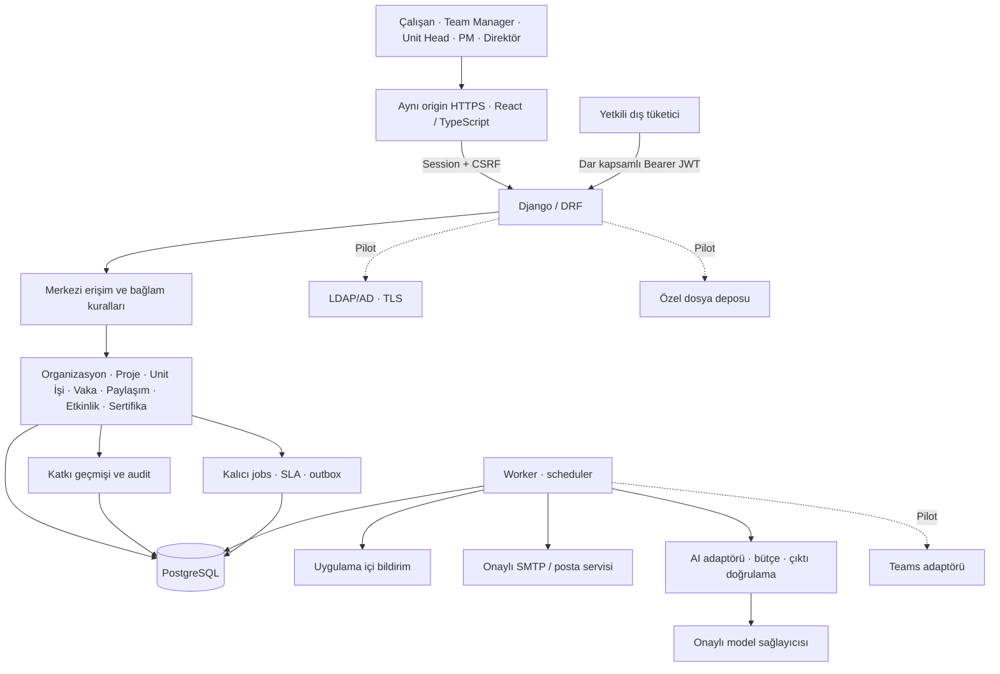
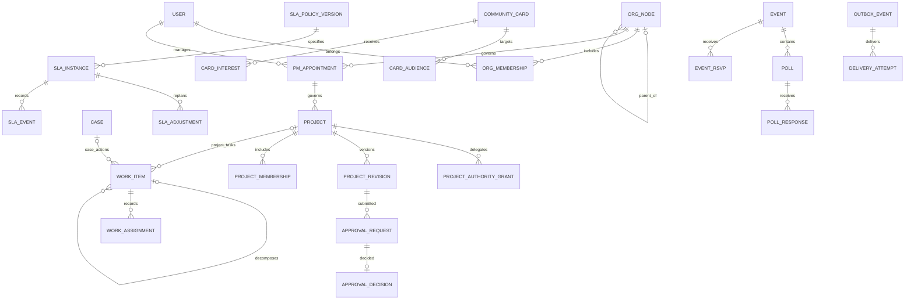
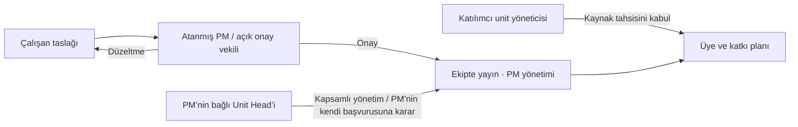
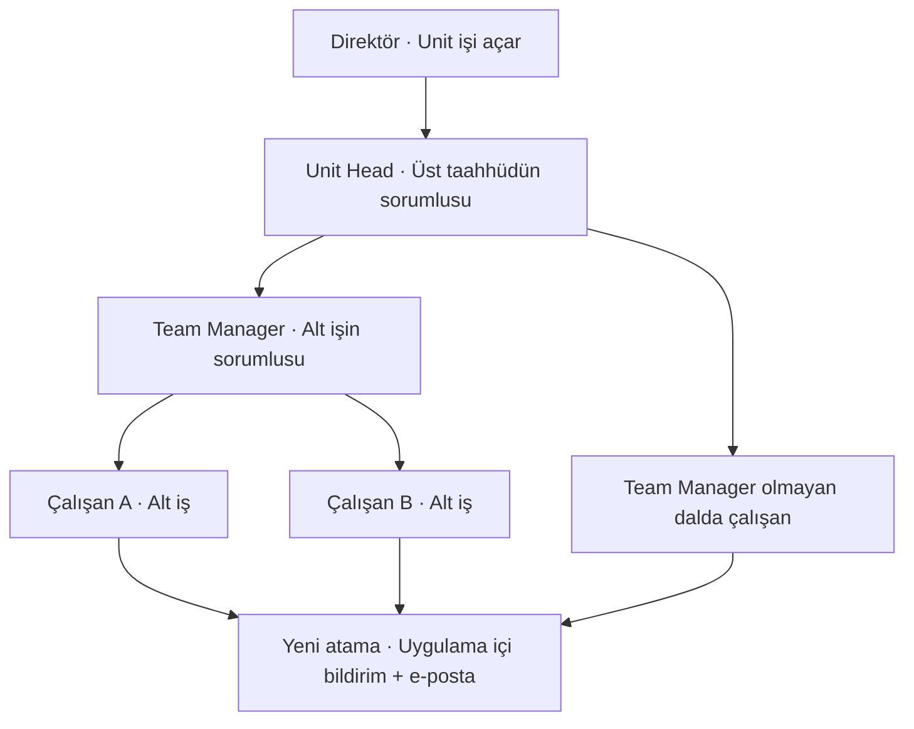

# Atlas — Siber Güvenlik Yönetim Platformu Mimari Tasarımı

18 Kasım 2026 · Revizyon 4 · Hedef mimari ve kararlar. Çalışan sürümün kapsamı [README](../README.md), doğrulama sonuçları [QA Raporu](QA_REPORT.md) içindedir; hedeflerin tamamı uygulanmış kabul edilmez.

Ürün kapsamı ve K01–K40 kabul senaryoları [Uygulama Planı](UYGULAMA_PLANI.md) belgesindedir. Bu revizyon yaklaşık 200 kişi, 1 direktör, 10–15 unit head, gerektiğinde team manager ve çalışanlardan oluşan organizasyonu esas alır. Son kullanıcı kararları: **projeleri proje yöneticisi yönetir; unit işleri organizasyon yöneticileri tarafından yönetilir; vakalarda ve yönetici atamalı işlerde değiştirilebilir süre hedefleri uygulanır; ekiplerin birbirini tanıması mevcut ekranlardaki kontrollü paylaşımlarla desteklenir.**

Öneri: **React + TypeScript arayüz, Django + Django REST Framework modüler monolit, PostgreSQL ve aynı uygulama kodundan çalışan kalıcı arka plan işleri.** Yetki; rol, organizasyon kapsamı, proje yönetim görevi, kayıt üyeliği ve işlem türünü birlikte değerlendirir. Barındırma kurumdaki onaylı ortamda yapılabilir; mimari belirli bir bulut sağlayıcısına bağlı değildir. Belgede ilk ürün sürümü, kurumsal pilot ve daha geniş hedef ayrılır; bütün kapsamın kısa bir hackathon süresinde tamamlanacağı varsayılmaz.

## 1. Temel kararlar

| Karar | Gerekçe / sonuç |
| --- | --- |
| Modüler monolit | Proje onayı, yayın, SLA başlangıcı, audit ve outbox aynı veritabanı işlemiyle tutarlı yönetilir. |
| Esnek ilişkisel organizasyon ağacı | Unit Head → çalışan ve Unit Head → Team Manager → çalışan birlikte desteklenir; kurum kodu yetki değildir. |
| Proje ve unit işi ayrı yönetim alanları | Proje yöneticisi (PM) proje kapsamını, üyeliğini ve işlerini yönetir. Unit Head/Team Manager kendi organizasyon işlerini yönetir. |
| PM’ye bağlı yönetim yetkisi | PM görevinin bağlı olduğu unitin Unit Head’i ve açık kapsamlı vekilleri proje yönetebilir; diğer unit headler otomatik proje yöneticisi olmaz. |
| Ortak iş altyapısı, bağlama göre ayrı yetki | `UNIT_WORK`, `PROJECT_TASK`, `CASE_ACTION` aynı kalıcı altyapıyı kullanır; sorgu ve yazma izinleri bağlam servisinden gelir. |
| Üst taahhüt sorumluluğu korunur | Alt işlere dağıtma üst işin hesap veren sahibini değiştirmez; kapanış ayrı doğrulanır. |
| Sürümlü süre politikası | Kritik 24 saat, yüksek 7 gün, normal 1 ay başlangıç hedefleridir; kurumsal iç koordinasyon hedefi olarak ayarlardan değişir. |
| Onay sadece gereken kararlarda | Çalışan proje başvurusu onaylanır. Günlük not ve politika içindeki küçük tarih değişimi ek onay beklemez. |
| Ekipler arası tanışma mevcut modüllerde | Ekip rehberi ve onaylı paylaşım kartları dashboard, organizasyon ve etkinliklere eklenir. Ham faaliyetler herkese açılmaz. |
| AI raporu ilk ürün sürümünde | Yıldızlanan işler ve kritik adaylardan kaynak bağlı yönetim taslağı; sayılar uygulama kurallarından gelir. |
| Kalıcı iş, checkpoint ve outbox | Rapor, SLA taraması ve bildirim kesinti sonrası sürer; session tek başına iş durumu değildir. |
| Teste özel God Mode | Sentetik ortamda tam erişim ve gerçek kullanıcı yetkisini deneme ayrı modlardır; üretimde bypass yoktur. |
| Sertifika ve dar API ilk ürün sürümünde | Yetkinlik metaverisi, seçilmiş son tarih uyarısı, salt okunur dış API ve OpenAPI/Swagger kapsam içindedir. |

200 kişilik başlangıç için mikroservis, Kafka, grafik veritabanı, Redis veya ayrı workflow motoru zorunlu değildir. Ölçülen bir ihtiyaç oluşursa ayrı karar kaydıyla eklenir. React/Django/PostgreSQL seçimi bu proje için öneridir. Uygulamaya başlarken desteklenen sürümler, güvenlik yamaları ve paket uyumu doğrulanıp sabitlenir.

## 2. Sistem bileşenleri ve modül sınırları

Kutular sorumluluk sınırıdır; her biri ayrı sunucu değildir. İlk dağıtım reverse proxy/statik arayüz, API, worker/scheduler ve PostgreSQL'den oluşur. İş kuralları API ve worker arasında ortak servislerdir. İstemci PostgreSQL'e, model sağlayıcısına veya posta servisine doğrudan bağlanmaz.

| Modül | Sahip olduğu iş |
| --- | --- |
| identity | Lokal/LDAP hesap eşleme, oturum, dış API kimliği ve iptal |
| organization | Organizasyon düğümleri, üyelik, yönetici kapsamı, ekip profilleri |
| access | Kayıt/alan/işlem yetkisi; organizasyon, PM görevi ve üyelik ilişkileri |
| projects | PM ataması, proje yönetim yetkisi, yayın sürümü, kaynak talepleri, proje işleri, kapanış |
| approvals | PM onay rotası, önemli değişiklik kararları ve sürümlü politika |
| work | Ortak iş/taahhüt altyapısı; `UNIT_WORK` atama ve alt iş kuralları |
| cases | Resmî vaka, ihbar, koordinatör, ekip aksiyonları ve kapanış doğrulaması |
| service_targets | SLA politika sürümü, hedef tarihi, uyarı, ihlal ve süre değişiklikleri |
| community | Onaylı başarı/yardım kartları, hedef kitle, ilgi ve destek talepleri |
| announcements | Anons önerisi, unit kararı, yayın hedefi ve süre |
| events | Etkinlik, tarih anketi, davetli, RSVP, gerçekleşmiş katılım |
| credentials | Bireysel/kurumsal sertifika metaverisi, önem ve yenileme uyarıları |
| notifications | Uygulama içi bildirim, outbox, e-posta/Teams adaptörleri |
| reporting / ai | Rapor seçkisi, sayılar, kaynak sürümleri, AI taslağı, token/maliyet kaydı |
| integration_api | Salt okunur dış API, OpenAPI/Swagger, ileride aynı policy kullanan MCP |
| audit / administration | İşlem izi, yönetim sekmeleri, secret referansları, test modu ve işletim |

Akış: **endpoint → doğrulanmış girdi → bağlama ait uygulama servisi → policy/domain kuralları → ORM**. Liste ve arama için merkezi yetkili sorgular kullanılır. Değişikliklerin transaction sınırı uygulama servisindedir. Bütün durumlar için serbest bir “status güncelle” API'si yerine gönder, onayla, ata, benimse, yeniden planla ve kapat gibi anlamlı işlemler tanımlanır.

## 3. Organizasyon ağacı ve kimlik ilişkileri

### 3.1 Düğümler ve üyelikler

`OrgNode`: sabit UUID, benzersiz kurum kodu, görünen ad, düğüm türü, `parent_id`, etkinlik ve sürüm. Türler Direktörlük / Unit / Ekip / Alt Ekip olabilir. Ağacın derinliği veriden gelir; her dalın dört düzey olması zorunlu değildir. Kişiler düğüm değil, düğümlere bağlı üyelik kayıtlarıdır.

`OrgMembership`: kişi, düğüm, birincil/ikincil üyelik ve geçerlilik tarihleri. MVP'de her etkin kişinin bir birincil organizasyon üyeliği bulunur. `RoleGrant`: kişi, rol, kapsam düğümü, alt dalları kapsama, başlangıç/bitiş ve veren yetkili. Aynı kişi birden çok düğümde yönetici olabilir.

`ICT-CS-OS` bir UNIT, `ICT-CS-OS-AST` ona bağlı bir TEAM örneğidir; ilk düğümde Unit Head, ikinci düğümde Team Manager görev yapar. Team Manager olmayan unitte çalışanlar doğrudan Unit Head kapsamındadır. Bu kodlar etiket/arama alanıdır. Üst-alt bağlantı `parent_id` ile tutulur. Kod değiştirmek yetkiyi değiştirmez. Kurumsal dizin grupları da doğrudan önek kuralıyla iş yetkisi vermez; doğrulanmış eşleme kullanır.

MVP için **parent ilişkisi + PostgreSQL recursive CTE** yeterli başlangıçtır. PostgreSQL hiyerarşik dolaşımı ve döngü tespitini destekler. Bu ürüne ilişkin tercihimiz, küçük organizasyonda önce tek kanonik üst-alt ilişki tutmak; gerektiğinde ölçümle türetilmiş closure/path indeksini eklemektir. [PostgreSQL recursive queries](https://www.postgresql.org/docs/current/queries-with.html)

Yazma kuralları: kendine bağlanma ve altına taşınarak döngü oluşturma yasaktır; düğüm başka direktörlüğe sessizce taşınamaz; bağlı aktif üyelik/kayıt varken fiziksel silme yapılmaz. Eşzamanlı taşımalarda ağaç değişikliği transaction ve ortak kilitle seri hale getirilir. Sadece ekranda döngü kontrolü yapmak yeterli değildir.

### 3.2 Organizasyon yöneticisi ile proje yöneticisinin ayrımı

Organizasyon ağacı **unit işi atama ve kaynak tahsisi** kapsamının kanonik kaynağıdır. Ayrıca çelişebilecek ikinci bir kişiden kişiye yönetici ağacı tutulmaz. En yakın aktif yönetici kişinin ilgili organizasyon düğümünden yukarı doğru geçerli rol atamalarıyla bulunur. Düğümde birden fazla yönetici varsa kaynak/iş kararının sorumlusu açıkça seçilir.

Proje onayı çalışanın bu zincirine otomatik gönderilmez. Başvuru, ilgili portföy veya proje alanına atanmış **PROJECT_MANAGER** görevine yönlenir. `ProjectManagerAppointment` PM’yi, proje/portföy kapsamını, atama tarihindeki bağlı unitini (`governing_org_id`) ve geçerliliğini saklar. Bu unitin geçerli Unit Head’i, PM görevinin yönetim üstü olarak aynı proje kapsamında yönetim hakkına sahiptir. Çalışanın veya projeye katkı veren başka bir unitin Unit Head’i bu nedenle proje yönetim hakkı kazanmaz.

PM veya bağlı Unit Head, sahip olduğu proje yetkilerinin bir alt kümesini süreli `ProjectAuthorityGrant` ile devredebilir. Devir belirli proje/portföy, işlem listesi, başlangıç/bitiş, gerekçe ve veren kişiyi taşır. Verenin hakkı bitince buna dayanan devir kullanılamaz; kendi kendine yükseltme veya yetkiyi genişletme yoktur. PM’nin kendi başvurusu bağlı Unit Head’e veya bağımsız yetkili vekile gider. Karar veren başvuranla aynı gerçek kullanıcı olamaz. Aynı kişi hem PM hem bağlı Unit Head rolünü taşısa da rol seçimi bu kontrolü aşamaz; istek bağımsız üst/vekil yetkiliye yönlenir.

Onay isteği atanmış kişiyi, PM atamasını, kullanılan politika/yetki sürümünü saklar. PM/vekil değiştiğinde bekleyen istek güncel yetkiliye yeniden yönlenir; eski kişi karar veremez. Uygun kişi bulunamazsa “Yönlendirme gerekiyor” durumu oluşur. Direktör denetim ve eskalasyon yetkisi taşır; her projede günlük işlemleri kendiliğinden devralmaz.

### 3.3 Organizasyon değişikliği

Ekip taşıma, üyelik ve rol değişikliği erişim sürümünü artırır; sonraki sunucu isteği yeni kapsamı kullanır. Önbellekler kapsam/sürümle anahtarlanır. Eski sayfa açık olsa bile yeni yazma, indirme ve arama istekleri eski yetkiyi kullanamaz.

Çalışan transferinde eski ekipten gelen otomatik haklar biter. Eski görev ve açık üyelikler devir listesine girer; eski ekibe dayalı ek yetkiler teyit edilene kadar askıya alınır. Ayrı onaylanmış proje/vaka görevlendirmesinin devamı ilgili yöneticilerce kararlaştırılır. Yazarın önceki katkıları ve o tarihteki ekip bilgisi değişmez. Kayıtların sahibi ekip, çalışanın yeni ekibine otomatik taşınmaz. `created_by` geçmiş bilgisidir; tek başına kalıcı okuma yetkisi değildir.

PM’nin değişmesi veya başka unite transferi, `governing_org_id` değerini ve devirleri sessizce değiştirmez. Yetkili direktör veya mevcut proje yönetişimi sorumlusu yeni PM atamasını ve bağlı unitini kontrollü devir işleminde teyit eder; eski görev ve ondan türeyen haklar sonlandırılır, yeni yönetim hakkı açıkça kurulur. Bekleyen onaylar yeniden yönlenir. Proje okuyucu kitlesi sırf PM’nin yeni unitine taşınmasıyla genişlemez.

## 4. Yetki modeli

### 4.1 Rol şablonları ve karar bileşimi

Organizasyon rolleri: **EMPLOYEE, TEAM_MANAGER, UNIT_HEAD, DIRECTOR, SYSTEM_ADMIN**. Proje görev/rolleri: **PROJECT_MANAGER, PROJECT_MEMBER**, isteğe bağlı teknik koordinasyon için **PROJECT_LEAD**. Proje lideri PM ile eş anlamlı değildir; liderlik tek başına onay veya proje yönetimi vermez. Vaka rolleri: **CASE_COORDINATOR, CASE_PARTICIPANT**. Bunlar tek kullanıcı rol alanına sıkıştırılmaz.

Her işlem için aktif hesap, işlem izni, kayıt kapsamı/ilişkisi, geçerli durum ve alan izinleri birlikte aranır. `WorkItem.context` hangi servisin yetki kontrolünü yapacağını belirler. `UNIT_WORK` için organizasyon ağacı, `PROJECT_TASK` için PM görevi ve proje yetki devri, `CASE_ACTION` için vaka koordinasyonu esas alınır. OWASP her istekte yetki kontrolünü ve ilişki/öznitelik tabanlı kararları önerir. [OWASP Authorization](https://cheatsheetseries.owasp.org/cheatsheets/Authorization_Cheat_Sheet.html)

| İşlem | Çalışan | Team Manager | Unit Head | Proje yöneticisi (PM) | Direktör |
| --- | --- | --- | --- | --- | --- |
| Proje taslağı oluştur/gönder | Evet, atanmış PM’ye | Evet, atanmış PM’ye | Evet, atanmış PM’ye | Evet; kendi başvurusunda bağımsız onay | Evet; açık doğrudan başlatma politikası ayrıca |
| Proje yayınını onayla | Yalnız ayrı açık proje yetkisi varsa | Sırf bu rol ile hayır | Yalnız PM’nin bağlı Unit Head’i veya açık proje yetkilisi ise | Atanmış kapsamında; kendi başvurusu hariç | Atanmış bağımsız onay veya açık politika kapsamında |
| Proje üyesi/teknik lideri ve işi yönet | Sadece açık sınırlı proje yetkisi | Sırf org rolüyle hayır | PM’nin bağlı Unit Head’i / açık yetkiliyse | Proje kapsamında; kaynak kabulü şartıyla | Denetim/eskalasyon; günlük yönetim açık atama ile |
| Unit işi/taahhüt aç ve ata | Kendisine | Kendi ekip alt ağacına | Kendi unit alt ağacına | Yalnız ayrıca org yöneticisiyse; aksi halde kendine | Bütün alt organizasyon kapsamına |
| Kendi katkısını düzelt | Evet, sürümlü | Evet, sürümlü | Evet, sürümlü | Evet, sürümlü | Evet, sürümlü |
| Başkasının katkısını onun adına değiştir | Hayır | Hayır | Hayır | Hayır | Hayır |
| Resmî vaka aç | İhbar/talep oluşturur | Yalnız açık `case.create` devriyle | Kendi kapsamında | Yalnız ayrıca vaka açma yetkisi varsa | Direktörlük kapsamında |
| Vaka kapanışını doğrula | Hayır | Açık doğrulama yetkisiyle | Atanmış kapsamda; kendi talebini doğrulayamaz | PM rolü tek başına yetmez | Atanmış kapsamda |
| Anons yayınla | Öneri verir | Açık yayın devriyle | Unit kararı ve hedef önizlemesiyle | PM rolü tek başına yayın yetkisi vermez | Direktörlük kapsamında |
| Etkinlik/anket aç | Katılır/önerir | Ekip kapsamında | Unit kapsamında | Açık etkinlik yetkisi varsa | Direktörlük kapsamında |
| Ekip paylaşımını yayınla | Taslak önerir | Açık unit yayın devriyle | Kendi unit kartı ve izinli hedef | Proje içeriğini onaylar; yayın hedefi için ayrıca scope | Yetkili kapsamda |

Okuma; yazma, onay veya atama hakkı değildir. Normal bir Unit Head başka unitin çalışanına hedef unitin kabulü olmadan iş/kaynak görevi veremez. Direktörün kendi alt kapsamındaki yetkili doğrudan ataması ayrı org kuralıdır. PM’nin proje üyesi seçmesi, o kişinin kaynak tahsisini kabul eden unit yöneticisinin yetkisini ortadan kaldırmaz; bu kabul proje içeriği/yayın onayı değildir.

### 4.2 Kayıt görünürlüğü

| Kayıt | Varsayılan okuyucular |
| --- | --- |
| Gönderilmemiş proje taslağı | Hazırlayan kişi |
| Gönderilmiş proje sürümü | Hazırlayan, atanmış PM/onaylayıcı, PM’nin bağlı Unit Head’i ve açık yetkili vekil |
| Yayınlanmış proje özeti | Açık yayın hedefindeki ekip, aktif üyeler, PM yönetimi, direktör; katılımcı yöneticilere izinli özet |
| Proje işi ve katkıları | İlgili üyeler ve PM yönetimi; katılımcı yöneticiye kendi ekibinin kaynak/katkı kapsamı ve izinli özet |
| Vaka ve vaka aksiyonu | Koordinatör, aktif katılımcılar, ilgili sahip/katılımcı yöneticiler ve direktör; ortak koordinasyon alanı |
| Unit işi/taahhüt | Atanan kişi, hâlen yetkili atayan, sorumlu birimin yönetici zinciri ve açık okuyucular |
| Alt iş | Kendi atananı ve bağlamın yetkilileri; üst kayda otomatik okuma vermez |
| Anons / paylaşım kartı | Onaylı yayın hedefi; kaynak kayda erişim ayrıca kontrol edilir |
| Ekip rehberi / uzmanlık | Paylaşım kapsamına açık profil alanları; çalışan iş ayrıntıları ayrı izne tabidir |
| Etkinlik / anket | Davetliler ve ilgili yönetici/düzenleyen; isimli yanıtlar daha dar kapsamda |
| Sertifika | Kişinin kendisi, ilgili yönetici ve yetkili denetim okuyucusu; tüm CS’ye açık değildir |

Yayındaki projenin sonraki değişiklik taslağı genel okuyuculara açık değildir; onaylanmış sürümü görmeye devam ederler. Yayın hedefi ve yönetim yetkisi ayrı ilişkilerdir. Bir ekibin açık proje listesinde yer almak, o ekibin Unit Head’ine proje düzenleme yetkisi vermez. Kaynak kabulü bütün unit çalışanlarını üye yapmaz. PM’ye bağlı yönetici hakkı da bütün unit çalışanlarına okuma hakkı vermez.

Unit işlerinin yönetim görünümü organizasyon zincirinden yukarı çıkar; proje yönetimi bu zincire otomatik bağlanmaz. Direktör yetkili operasyon özeti ve kritik kararları görür. Gönderilmemiş kişisel taslaklar istisnadır. Kullanıcıya “direktör görmesin” gibi genel bir seçenek sunulmaz; gelecekte HR/hukuk gibi özel alanlar gerekirse ayrı politika kurulur.

MVP’de aynı vaka altında birbirinden gizli teknik yorum katmanları kurulmaz. Ortak vaka paylaşılabilir koordinasyon özeti tutar; hassas teknik kanıt kaynak sistemin izinleri altında kalır. Bir vaka/projeyi başka kayda bağlamak, kaynak bağlantısı veya paylaşım kartı oluşturmak erişimleri birleştirmez.

### 4.3 Kontrol yüzeyleri

Liste, detay, oluşturma, güncelleme, atama, onay, autocomplete, arama, sayaç, ağaç sayıları, rapor, çıktı, bildirim ve worker aynı politika tanımlarını kullanır. DRF liste sonuçlarına nesne yetkilerini kendiliğinden tek tek uygulamaz; oluşturma kontrolü de ayrıca gerekir. Bu yüzden sorgu kapsamı ve oluşturma servisi açıkça yetkilendirilir. [DRF permissions](https://www.django-rest-framework.org/api-guide/permissions/)

İstemcinin gönderdiği `org_id`, kişi veya proje kimliği güvenilir yetki kanıtı sayılmaz. Sunucu aday kişileri ve hedef kaydı yeniden doğrular. Yetkisiz kaydın başlığı/sayısı arama ve bildirimle açıklanmaz. Yetkisiz nesne için tutarlı “bulunamadı/erişim yok” davranışı seçilir; kullanıcı hatasında iç sorgu bilgisi döndürülmez.

### 4.4 System Admin ve test God Mode

Test ortamında System Admin bütün **sentetik** organizasyon, proje, iş ve vaka kayıtlarını görüp yönetebilir. Ayrıca belirli bir kullanıcı/rol görünümüne girerek o kişinin gerçek policy sonucunu deneyebilir. God Mode erişim genişletmesi ile “bu kişi gibi gör” modu ayrı işlemlerdir; rol görünümü testinde tam erişim bypass'ı kapanır.

Kayıtta gerçek aktör ve testte adına işlem yapılan kişi ayrı tutulur. Değişmez iş kuralları (geçersiz durum, çift oy, bozuk ilişki, silinmiş audit) tam erişimde de geçerlidir. Demo verisini sıfırlama ayrı test aracıdır; bir onay işlemi gibi gösterilmez.

Üretimde God Mode için güvenilen ortam yapılandırması ve sunucu engeli bulunur; tarayıcı parametresiyle açılamaz. Üretim System Admin teknik yönetim yapar; iş içeriği için ayrıca iş rolü gerekir. Üretimde kendi kendine direktör/iş rolü verme engellenir; iş rolü değişimini yetkili iş yöneticisi onaylar. Test modu açık üretim yapılandırması başlangıç kontrolünde reddedilir. Django'nun teknik `is_superuser` niteliği uygulamadaki iş rolü yerine kullanılmaz.

## 5. Mantıksal veri modeli

Bu tablo şema sözleşmesidir; migration veya uygulama kodu değildir. İsimler geliştirme sırasında değişebilir; ilişkiler ve kurallar korunur.

| Varlık | Temel bilgiler ve değişmez kural |
| --- | --- |
| User / ExternalIdentity | UUID, etkinlik, doğrulanmış kurumsal e-posta, dış sağlayıcı + sabit kimlik; isim/e-posta kimlik birleştirme anahtarı değildir. |
| OrgNode / OrgMembership | Üst-alt düğüm, kod/tür, kişi üyeliği ve geçerlilik; bir aktif birincil üyelik. |
| RoleGrant / Delegation | Org rolü, kapsam, altları kapsama, süre, veren; devir verenin hakkını genişletemez. |
| ProjectManagerAppointment | PM, proje/portföy kapsamı, `governing_org_id`, başlangıç/bitiş, atayan ve sürüm; bağlı unit kontrollü devirle değişir. |
| ProjectAuthorityGrant | Proje/portföy, yetkili kişi, izin listesi, süre, dayanak PM/Unit Head görevi, veren ve gerekçe; dayanak iptalinde kullanılamaz. |
| Project | Hazırlayanın kaynak düğümü, atanmış PM görevi, yönetim unit referansı, iş durumu, onaylı yayın sürümü ve sürüm sayacı. |
| ProjectRevision | Başlık, amaç, kapsam, taahhüt tarihleri, yayın hedefi; değişmez içerik sürümü ve başvuru durumu. |
| ProjectMembership | Proje, kişi, üye/isteğe bağlı teknik lider, katılımcı düğüm ve geçerlilik; PM yetkisi üyelikten ayrı. |
| ParticipationRequest | Proje/vaka/iş, hedef birim, kişiler, paylaşılabilir kaynak talebi, karar sorumlusu ve kabul/red; kabul öncesi üyelik/atama yok. |
| ApprovalPolicyVersion | Hangi değişikliğin onay istediği, doğrudan direktör başlatma izni, sınırlar ve yürürlük; eski kararın politikası korunur. |
| ApprovalRequest / ApprovalDecision | İçerik sürümü, başvuran, atanmış onaylayıcı, PM/yetki/politika sürümü, gerekçe ve zaman; bir nihai karar. |
| WorkItem | `context=UNIT_WORK/PROJECT_TASK/CASE_ACTION`, iş/taahhüt türü, beklenen çıktı, sorumlu org, tek sorumlu, üst iş, proje/vaka FK, termin ve sürüm. |
| WorkAssignment | Önceki/yeni sorumlu, atayan, atama sürümü, zaman; yeniden atama geçmişi ve bildirim olayı. |
| WorkDependency | Bekleyen/önkoşul iş, zorunluluk; döngü yok, farklı bağlamda yalnız açık bağlantı. |
| CaseNotice / Case | Çalışan ihbarı ve ona bağlı resmî vaka ayrı; vaka türü, öncelik, koordinatör, kaynak, durum, kapanış/doğrulama. |
| CaseMembership / CaseTeam | Aktif kişi rolü ve katılan ekip; ekip kaydı bütün çalışanlara erişim vermez. |
| ProjectCaseLink | Vaka–proje ilişkisi; devir amacı/gerekçesi; erişim vermez. |
| SLAPolicyVersion | Kapsam, öncelik, hedef türü, süre miktarı/birimi, takvim/zone, başlatma/durdurma kuralları, uyarı eşikleri, yayın sürümü. |
| SLAInstance | Vaka veya unit işine tek aktif hedef, politika snapshot’ı, `started_at`, `original_due_at`, `current_due_at`, saat durumu, kapanış, kalıcı ihlal izi ve sürüm. |
| SLAAdjustment / SLAEvent | Tarih/politika/öncelik değişiminin aktörü/gerekçesi/önce-sonrası; uyarı, ihlal, yeniden açma ve kesinti telafisi olayları. |
| ProgressEntry / ProgressRevision | Yapılanlar, sonraki adım, engel, gerçek yazar, o andaki ekip, zaman ve önceki sürüm; tek üst bağlam. |
| ActivityEvent / AuditEvent | İş/güvenlik hareketi; gerçek ve varsa test etkin aktörü, nesne, eylem, maskeli fark, zaman. |
| TeamProfile / ExpertiseDeclaration | Ekip görevi, temas noktası, hizmet/uzmanlık etiketleri; kişisel uzmanlık kendi beyanıdır, performans puanı değildir. |
| CommunityCard / CardAudience / CardInterest | Kaynak kimlik/sürümü, ayrı paylaşım metni, başarı/yardım isteği/destek teklifi, yayın kararı, hedef ve geçerlilik; ilgi iş atamaz. |
| Announcement / AnnouncementAudience | Yayınlayan unit, sürüm, hedef, başlangıç/bitiş, sabitleme, karar bilgisi. |
| Event / EventInvitee | Düzenleyen, kapsam, yer/zaman, durum, davetli listesi ve sürümü. |
| Poll / PollOption / PollElector | Soru, seçim sınırı, açılış/kapanış, seçenekler ve seçmen listesi. |
| PollResponse / PollSelection | Anket + kişi tek etkin yanıt; seçenek aynı ankete ait. |
| EventRSVP / EventAttendance | Etkinlik + kişi katılım yanıtı ve gerçekleşmiş katılım ayrı kayıtlar. |
| Credential / CredentialAlertPolicy | Kişi/kurum sahibi, ad, veren kurum, edinme/sona erme, doğrulama referansı, önem; yönetici seçimine bağlı uyarı. |
| ReportSelection / ReportSnapshot | Dönem, yıldız/otomatik kritik aday/ekleme nedeni, onay durumu; kesim, kaynak kimlik/sürümü ve okuyucu kapsamı. |
| AIJob / AIUsage / AIPriceVersion | İstek sahibi, iş türü, kaynak/kapsam/model/prompt sürümü, token bütçesi, çıktı durumu; giriş/çıkış tokenı, sağlayıcı bilgisi, hesaplanan maliyet ve fiyat sürümü. |
| BackgroundJob / JobCheckpoint | Tür, aktör, request UUID, checkpoint, lease/fencing sürümü, deneme, sonraki çalışma, çıktı referansı ve hata sınıfı. |
| Notification / DeliveryAttempt / OutboxEvent | Alıcı/kanal/olay tekilliği, atama/SLA sürümü, minimal girdi, lease, deneme ve servis sonucu. |
| ApiClient / TokenGrant | Servis kimliği, dar okuma scope’u, org/kayıt kapsamı, son kullanım, iptal ve süre; admin olmak otomatik içerik izni değildir. |
| IntegrationConfiguration / ConfigurationVersion | LDAP, SMTP, Teams, AI ayarları ve secret referansı, aktif sürüm, bağlantı testi sonucu; açık sır geri okunmaz. |

### 5.1 Tutarlılık kuralları

- `UNIT_WORK`: proje/vaka FK’leri boş; `PROJECT_TASK`: yalnız proje dolu; `CASE_ACTION`: yalnız vaka dolu. DB check kısıtı ve bağlam servisi birlikte uygular. Kullanıcı `context` değiştirerek yetki yükseltemez.
- Alt iş aynı bağlamı ve proje/vaka kimliğini korur; üst bağlantı döngü oluşturamaz. Farklı proje/vakadaki önkoşul alt iş yapılmaz, yetkili bağımlılık bağlantısı olarak kurulur. Projeye/vakaya devir yeni bağlamda yetkili işlem ve açık kaynak bağlantısıyla yapılır; mevcut işin erişimi sessizce dönüşmez.
- Her yayınlanmış projenin bir etkin sorumlu PM görevi vardır; isteğe bağlı teknik lider farklıdır. PM ataması/bağlı unit devirleri atomiktir.
- Etkin işte tek sorumlu vardır. Henüz kabul edilmemiş dış ekip isteği atanmış iş sayılmaz. Üst işin hesap veren sorumlusu alt iş dağıtımından etkilenmez.
- Yönetici tarafından atanan unit işi/taahhütte öncelik ve formal hedef zorunludur. Çalışanın kişisel işinde hedef tarih isteğe bağlıdır. Taahhütte beklenen çıktı ve tarih bulunur. “Gecikti” kullanıcı tarafından yazılabilir durum değildir.
- Formal hedef bir vaka veya unit işine bağlıdır; `SLAInstance` aynı anda ikisine bağlanamaz. Proje işine varsayılan unit SLA’sı eklenmez. Hedef revizyonu geçmiş ihlali silmez.
- Anket/kişi tek yanıt; seçimlerin aynı ankete ait olması, tek/çok seçim sınırı ve seçenek tekilliği DB/servis kurallarıyla doğrulanır. Yanıtsız durum boş tercih ile karıştırılmaz.
- İlerleme tek proje/vaka/işe bağlanır; üst akışlarda referansla gösterilir, kopyalanmaz. Paylaşım kartı ise onaylı ayrı metindir; ham ilerleme alanı değildir.
- Zamanlar UTC saklanır; takvim matematiği ve gösterim Europe/Istanbul’dur. 24 saat geçen süre, 7 gün takvim günü, 1 ay takvim ayı olarak açık birim taşır. Sadece gün belirtilen kişisel/proje termini yerel gün sonuna çevrilir.
- Düzenlenebilir ana kayıtta sürüm vardır; eski sürümle yazma 409 verir. Unique/check/FK ile ifade edilebilen kurallar DB’de, kalanlar transaction içindeki servislerde korunur.

## 6. Proje başvurusu ve yaşam döngüsü

### 6.1 İlk yayın ve PM onayı

1. Çalışan proje taslağını açar; ilgili ekip/yayın hedefini ve proje alanını seçer. Hazırlayan otomatik PM veya teknik lider olmaz.
2. Gerekli içerik ve tarihler doğrulanır; portföy/proje alanının etkin PM’si belirlenir. Belirsiz rotada başvuru yönlendirme kuyruğuna düşer; sıradan unit yöneticisine otomatik gönderilmez.
3. Değişmez `ProjectRevision`, politika sürümü ve `ApprovalRequest` kaydedilir; taslak henüz ekip açık projelerinde görünmez.
4. Atanmış PM veya aynı kapsam için açık onay devri bulunan kişi inceler. PM’nin kendi önerisinde PM’nin bağlı Unit Head’i veya bağımsız yetkili vekil karar verir.
5. Düzeltme/red gerekçelidir. Düzeltme yeni sürüm doğurur; eski karar silinmez. Kararda güncel yetki, istenen sürüm ve başvuran–karar veren ayrılığı yeniden doğrulanır.
6. **Karar + yayın sürümü + etkin PM görevi + kabul edilmiş üyelikler + audit + outbox** tek transaction’da yazılır. İlk iş durumu Planlandı’dır.
7. Onaylı özet belirlenen ekibin açık projelerinde görünür. Bu yayın o ekibin yöneticisini PM yapmaz. Ek unit/direktör onayı varsayılan zorunluluk değildir.

Başvuru nihai karardan önce geri çekilebilir. Eski/geri çekilmiş sürüme onay verilemez; çift tıklama iki yayın oluşturmaz. Direktör için politika ile açıkça etkinleştirilen **doğrudan proje başlatma** ayrı işlemdir: yetki, gerekçe, atanmış PM ve yayın kitlesi kaydedilir. Bu işlem kendi başvurusunu onaylama olarak gösterilmez. Çalışan başvurularında onay varsayılanı korunur; doğrudan başlatma kapalıysa direktör başvurusu da bağımsız tanımlı onay rotasına gider.

### 6.2 Proje yönetimi, üyelik ve önemli değişiklik

Projenin kapsam, plan, üye rolleri, proje işleri, ilerleme ve kapanış yönetimi PM’dedir. PM’nin bağlı Unit Head’i ve açık yetkili vekiller aynı kapsamda işlem yapabilir. Katılan unit yöneticileri kendi çalışanlarının kapasite/kaynak tahsisini kararlaştırır; bütün projenin içeriğini veya işlerini sırf org hiyerarşisi nedeniyle düzenleyemez.

PM yeni üye/teknik lider önerir. Hedef unitin yetkili yöneticisi gerekli kapasiteyi kabul ettiğinde üyelik, katılan ekip ve bildirim atomik oluşur; reddederse PM yeniden planlar. Karar verene yalnız paylaşılabilir talep özeti gösterilir. Kabul bütün kaynak proje/vaka ayrıntılarına sınırsız erişim sağlamaz. PM kabul edilmiş üyeye proje işi dağıtır; teknik lider ancak açıkça verilen sınırlı görev koordinasyon iznini kullanır.

Onay politikası sürümlüdür: ana amaç/kapsam, dış yönetim taahhüdü, yönetim unit/PM devri, bütçe taahhüdü veya okuyucu kitlesini genişletme önemli değişikliktir. PM’nin politika sınırı içindeki küçük görev tarihi ayarlaması, ilerleme notu ve görev durum değişimi audit ile hemen uygulanır. Küçük ayar dış taahhüdü etkiliyorsa önemli değişiklik sayılır. Her not/tarih hareketi yeni onay kuyruğu yaratmaz. Erişimi daraltma ve üyeyi çıkarma yetkili kişinin hemen uygulayabileceği ayrı güvenlik işlemidir.

### 6.3 İlerleme, kapanış ve aylık görünüm

İş durumu: **Planlandı → Devam Ediyor ↔ Beklemede → Tamamlandı**; gerekçeli İptal ve Yeniden Aç vardır. İlk sürümde PM’nin yüzdesi, gerekçesi ve güncelleme zamanı “beyan edilen ilerleme” diye etiketlenir. Ağırlıklı kilometre taşı/teslim hesabı sonraki fazdadır. Alt iş sayısı veya AI tahmini kesin tamamlanma yüzdesi gibi gösterilmez.

Üye/teknik lider tamamlanma önerir, PM zorunlu teslimleri ve sonuç özetini doğrulayarak kapatır. PM kendi kapanış talebinin bağımsız doğrulaması gerekiyorsa bağlı Unit Head/vekil rotası kullanılır; politika ve karar kaydedilir. İlk yayın onayı ile kapanış ayrı olaylardır. Sonraki fazdaki aylık snapshot kesim tarihi, kaynak sürümleri, durum ve ölçüm yöntemini saklar; geçmiş rapor güncel veriyle sessizce değişmez. İlk sürüm kaynak bağlı Markdown ve tarayıcıdan PDF olarak kaydedilebilir yazdırma görünümü verir. Sunucuda PDF üretimi pilotta, sunum şablonu sonraki fazda tamamlanır.

## 7. İş/taahhüt, alt iş ve atama

### 7.1 Unit işinin organizasyon üzerinden dağıtımı

**İşler ve Taahhütler ekranının varsayılanı `UNIT_WORK` olur.** Direktör kendi altındaki unit head, team manager veya çalışana; Unit Head kendi unitinin alt yönetici/çalışanlarına; Team Manager kendi ekip alt ağacına iş açabilir. Bir alt basamakla sınırlı değildir. Çalışan kendine unit işi açabilir. Yönetici rolü olmayan PM’nin unit işi atama hakkı kendisine iş açmayla sınırlıdır.

Sunucu aktif rolü, hedef kişinin etkinliğini, organizasyon üyeliğini, bağlamı, kayıt erişimini ve sürümü kontrol eder. `owner_org_id` sorumlu birimi gösterir: Unit Head’e verilen yönetsel görevde unit, çalışana verilen işte ilgili ekip. İstemciden gelen düğüm otomatik kabul edilmez. Kapsam dışı kaynak için hedef unitin kabulü veya yetkili ortak üst yönetim kararı gerekir.

Proje işleri Projeler altında PM yetkisiyle, vaka aksiyonları Vakalar altında koordinatör yetkisiyle yönetilir. **Bana Atananlar**, kişinin bütün bağlamlardaki yetkili görevlerini birlikte gösterebilir; kart bağlam ve kaynak rozetini taşır. Bu birleşik görünüm hiçbir bağlam için ek yazma yetkisi vermez.

Alt iş oluşturmak üst taahhüdün sorumlusunu değiştirmez. Açık zorunlu alt işler kapanışı engeller. Çocuklar bitince üst sorumlu sonuç verir; üst taahhüt kendiliğinden kapanmaz. Resmî unit işinde sorumlu tamamlanma bildirir ve kayıt Doğrulama Bekliyor durumuna gelir. Atayan yönetici veya yetkili iş karar sahibi kabul ettiğinde Tamamlandı olur ve SLA durur. Sorumlu ile kabul eden aynı gerçek kişiyse bağımsız üst/vekil kararı gerekir. Kişisel işi kişi doğrudan tamamlayabilir. Rutin katkı güncellemesi onaysızdır; bu kapanış kabulünden ayrıdır. Alt işin tarihi üst hedefi aşıyorsa uyumsuzluk gösterilir; üst tarihin değişmesi ayrı gerekçeli yetkili işlemdir.

Alt iş okuyucusu üst kayda yetkili değilse üst başlık/kimlik gizlenir; alt işe açıkça eklenmiş paylaşılabilir çıktı özeti gösterilir. Devir, alt iş oluşturma ve yeniden atama farklı işlemlerdir. Farklı bağlamdaki önkoşullar referans olarak bağlanır; erişim birleştirmez.

### 7.2 Formal hedef ile kişisel plan ayrımı

Direktör, Unit Head veya Team Manager’ın açıp atadığı/etkinleştirdiği unit işinde öncelik seçilir ve sürümlü SLA politikasıyla hedef hesaplanır. Yönetici taslağı varsa süre taslakta başlamaz; ilk yetkili atamanın commit zamanı başlangıçtır. Yöneticinin kendine açtığı resmî unit görevi de etkinleştirmede aynı kurala tabidir. Yönetici de açıkça “kişisel iş” türünde kayıt açabilir; bu kayıt formal SLA taşımaz. Daha önce etkinleştirilmiş resmî işi kişisele çevirerek süreyi/ihlali kaldırmak yasaktır.

Çalışanın kendine açtığı kişisel işte isteğe bağlı termin ve kişisel öncelik bulunur; bu bir formal SLA değildir. Yönetici **“Yönetim takibine al / benimse”** işlemiyle öncelik ve sorumluyu teyit edince formal hedef o commit anından başlar. Eski kişisel tarih korunur, geçmişe dönük ihlal icat edilmez. Bundan sonraki yeniden atama veya alt işe bölme saati sıfırlamaz. Proje görevlerinin PM termini ayrı tutulur; unit SLA’sı otomatik uygulanmaz.

### 7.3 Atama işleminin sınırı

**İş/atama değişimi + gerekiyorsa ilk SLA instance’ı + atama sürümü + faaliyet/audit + outbox** tek transaction’dır. Kullanıcıya başarı commit sonrası gösterilir. E-posta veya model cevabı beklenirken DB kilidi tutulmaz.

İstek tekrarında aktör + işlem + request UUID tekildir; aynı anahtar/farklı içerik reddedilir. Başarılı isteğin tekrarı yeni atama, SLA veya mail üretmez. Başka kişiye yeniden atama yeni atama sürümü ve bildirim olayıdır; SLA başlangıcı değişmez.

Çalışan kendi durum/ilerlemesini düzeltir; formal hedef ve sorumluyu değiştirmek bağlamın yetkisine bağlıdır. Beklemede engel/beklenen taraf, tamamlamada sonuç yazılır. Doğrulama bekleyen formal işin saati varsayılan olarak işler. Kapanan/iptal kayıt aktif gecikme sayacından çıkar; tarihsel ihlal kaydı korunur. Yeniden açma gerekçelidir ve aynı hedef geçmişini kullanır. Katkılar gerçek kullanıcıyla sürümlenir.

## 8. Vaka akışı ve süre hedefleri

### 8.1 Vaka açma ve koordinasyon

Kesin kullanıcı gereksinimi, resmî vakayı kendi kapsamında **Unit Head’in** açabilmesidir. Bu tasarımda önerilen ve kurum politikasında teyit edilecek tamamlayıcı varsayılanlar: direktör kendi kapsamında açabilir; Team Manager yalnız süreli/kapsamlı `case.create` devri varsa açar; çalışan `CaseNotice` ile ihbar/talep gönderebilir; bu henüz resmî vaka veya SLA değildir. Yetkili yönetici ihbarı değerlendirip vakaya dönüştürür veya gerekçeli kapatır. Acil güvenlik olaylarında mevcut kurumsal incident kanalı hemen kullanılır; ihbar/onay ekranı müdahalenin başlaması için bekleme noktası olmaz.

Vaka türleri Güvenlik Olayı / Zafiyet Takibi / Operasyonel Sorun olarak ayrılır. Durum: **Yeni → Değerlendiriliyor → İşlemde → Doğrulama Bekliyor → Kapandı**. Bekleme nedeni ayrı alan; İptal/Mükerrer ve Yeniden Aç gerekçeli işlemlerdir.

Yetkili açan kişi önceliği seçer; resmî vaka + SLA başlangıcı + koordinatör/üyelik + audit/outbox aynı transaction’da oluşur. Açan geçici koordinatör olabilir; asıl koordinatör atanır. Koordinatör kabul edilmiş ekip/kişilere `CASE_ACTION` açar. Başka unitin katılımı talep/kabul ile gerçekleşir; bekleyen talep atanmış aksiyon değildir. Vaka SLA’sı ilk sürümde vaka üzerindedir, her alt aksiyona kopyalanmaz; aksiyonların hedefi vaka planıyla uyumlu seçilir.

CDC, OffSec/OVSec, IAM ve Firewall tek vaka altında ayrı aksiyon, sorumlu, yapılanlar, sonraki adım ve kanıt referansı tutar. Kurumun kesin ekip adı ayarlardan yönetilir; örnek adlar yetki üretmez. Aynı vaka ekip başına çoğaltılmaz. Alt aksiyon katkısı vaka akışında kaynak kimliğiyle gösterilir.

Koordinatör kapanışta sonuç, doğrulama kanıtı ve kalan işleri belirtir. Atanmış sahip ekip yöneticisi doğrular; talep sahibiyle aynı kişiyse bağımsız üst/vekil rotası kullanılır. Zorunlu açık aksiyon ve sonuçsuz doğrulama kapanışı engeller. Uzun vadeli iyileştirme başka proje/işe taşınırsa gerekçe ve yeni kayıt ilişkisi gerekir; zorunluluk keyfî silinmez. Teknik risk kabulü kurumun ayrı sürecine bağlıdır.

### 8.2 Varsayılan süre politikası

| Öncelik | İlk yapılandırma | Hesaplama |
| --- | --- | --- |
| Kritik | 24 saat | Başlangıçtan itibaren 24 geçen saat |
| Yüksek | 7 gün | Europe/Istanbul’da 7 takvim günü; aynı yerel saat |
| Normal | 1 ay | Europe/Istanbul’da 1 takvim ayı; gün yoksa ayın son gününe kırpılır |

Bunlar kullanıcı ihtiyacı için önerilen **iç tamamlama/koordinasyon hedefleridir**; sektörün olay müdahale standardı veya yasal süre olarak sunulmaz. Kritik olayın ilk müdahalesi 24 saat bekletilmez. İlk yanıt, kontrol altına alma ve çözüm hedefleri istenirse ayrı politika türleriyle tanımlanır; birbirleri yerine raporlanmaz. “SLA” UI etiketi iç hedef anlamıyla açıklanır.

Öncelik adları, miktar/birim, iş/vaka kapsamı, uyarı eşikleri ve eskalasyon ayarlarda yetkili kullanıcı tarafından sürümlenir. Vaka saati resmî oluşturma commit’inde; yönetici unit işi ilk yetkili atama/etkinleştirme commit’inde; kişisel iş benimseme commit’inde başlar. İhbar ve taslak yaşları ayrıca gösterilir, formal hedef süresiyle karıştırılmaz.

### 8.3 Saat, tarih değişimi ve ihlal geçmişi

- Varsayılan duraklatma yoktur. Beklemede ve doğrulama bekliyor durumları süreyi durdurmaz. İleride duraklatma açılırsa yetkili, gerekçeli, başlangıç/bitişi kayıtlı aralıklar gerekir; açık uçlu sessiz duraklatma olmaz.
- İlk hedef `original_due_at`, güncel hedef `current_due_at` olarak korunur. Yetkili tarih/öncelik değişikliği `SLAAdjustment` ile eski–yeni değer, aktör, gerekçe ve politika sürümünü saklar. İşi açan yetkili yönetici veya açık SLA karar sahibi değiştirir; kişi kendi lehine hedef uzatmayı aynı kullanıcıyla farklı role geçerek onaylayamaz, üst/bağımsız vekil kararı gerekir.
- Yönetici hedefi ileri alsa bile önce gerçekleşmiş ihlal silinmez. Süreyi uzatmadan önce mevcut saatle ihlal kontrolü aynı transaction’da yapılır; tarayıcı/worker çalışmadı diye ihlal görünmez olmaz.
- Süre/öncelik değişimini işi açan yetkili yönetici veya atanmış SLA karar sahibi yapar. Sorumlu kişi kendi lehine süre uzatmasını onaylayamaz; üst/bağımsız vekil kararı gerekir. Daha yüksek öncelik seçimi sessizce daha ileri son tarih üretmez; politika hesabı ve mevcut hedef birlikte doğrulanır.
- Politika değişimi varsayılan olarak yalnız yeni kayıtları etkiler. Açık kayıtları güncellemek açık “yeniden planla” işlemi, kapsam önizlemesi ve gerekçe gerektirir; toplu değişiklik de tek tek izlenebilir.
- Yeniden atama, alt iş dağıtımı, birim değişimi ve yeniden açma başlangıcı sıfırlamaz. Kapanışta süre durumu kaydedilir; yeniden açmada aynı orijinal başlangıç/hedef kullanılır. Geçmiş tamamlanma/ihlal korunur; yeni bir bağımsız hedef gerekiyorsa bağlantılı yeni iş açılır.
- Varsayılan uyarı tüketilen hedefin %80’i, ihlal %100’üdür. Eşikler ayarlanabilir. Alıcı sorumlu ve yetkili yöneticidir; devam eden ihlal ilgili Unit Head/direktör eskalasyon rotasına gider. Proje kaynak sahibine görünürlük ayrı policy’ye tabidir.
- İşlemler UTC saklanır; takvim birimi açıkça taşınır. Örnek: 31 Ocak + 1 takvim ayı ilgili yılın 28/29 Şubat gününe, aynı yerel saate gider. “1 ay” sabit 30 gün olarak hesaplanmaz.

### 8.4 Kalıcı SLA yürütmesi

Scheduler DB’deki etkin `SLAInstance` ve kalıcı `next_check_at` alanlarını tarar. Lease/fencing sürümüyle sahiplenir; güncel kayıt sürümü ve hedef durumunu transaction’da yeniden kontrol eder; gereken `SLAEvent` ve outbox olayını aynı transaction’da yazar. Uyarı tekillik anahtarı instance + hedef revizyonu + eşik + alıcı/kanaldır. Eski worker yeni tarihe göre iptal edilmiş uyarıyı yayınlayamaz.

Sistem kesintisinde saat gerçek zamana göre işlemeye devam eder; başlatma/sona erme verisi DB’dedir. Yeniden başlatmada geçmiş eşikler uzlaştırılır: ihlal gerçekleşmişse “gecikmeli tespit” zamanı ile gerçek eşik zamanı ayrı kaydedilir; birikmiş %80 ve %100 uyarıları art arda gereksiz bildirim yerine anlamlı güncel duruma indirgenir. Tarihsel olay korunur. Aynı anda kapanış, yeniden planlama, yeniden atama veya iki scheduler çalışması çakıştığında tek geçerli sonuç ve bildirim üretilmesi PostgreSQL transaction testleriyle doğrulanır.

## 9. Anons ve etkinlik davranışı

### 9.1 Anons

Öneri → unit head incelemesi → yayın akışı veya unit head'in doğrudan yayını desteklenir. Team manager yalnız açık vekâletle yayınlar. Unit head'in tüm CS'ye yayın hakkı MVP kararına dahildir. Hedefler: kendi unitim, seçili ekipler, tüm direktörlük.

Anons içeriği, hedef kitle, yayın süresi ve yayınlayan unit aynı sürüme bağlıdır. Onay/yayın sırasında hedef kitle yeniden hesaplanır ve alıcı önizlemesiyle karşılaştırılır. Yayında içerik/kitle değişirse yeni sürüm, yetki kontrolü ve audit oluşur. Süre aralığına giren aktif yayın dashboard'da görünür; bitenler arşivlenir. Acil geri çekme anında uygulanabilir.

Anons etiketi tek başına bir proje/vakayı herkese açmaz. Bağlı kayıttan hassas başlık/özet otomatik alınmaz. Dashboard anons sorgusu hedef kitleyle filtrelenir. MVP'de anonslar uygulama içindedir; atama e-postası özelliği bütün anonsların e-postalanacağı anlamına gelmez.

### 9.2 Etkinlik, anket ve katılım

Etkinlik oluşturma izni yönetilen ekip/unit/direktörlük kapsamına bağlıdır. Ortak unit etkinliği ilgili unit onayı veya direktör kararıyla açılır. Etkinlik ve anket durumları ayrıdır; anket kapanınca etkinlik otomatik kesinleşmez.

Anket açılırken seçenekler, tek/çok seçim, kapanış zamanı ve seçmen listesi sabitlenir. İlk oydan sonra seçeneklerin anlamı değiştirilmez; yeni anket açılır. Davetli listesi değişimi sürümlenir ve paydada gösterilir. Kapanış kontrolü sunucu zamanıyla ve yanıt kaydıyla aynı transaction'da yapılır; yarışan oy/kapat işlemleri tutarlı sonuç verir.

Her kişi/anket yanıtı tekildir. Kapanışa kadar değişiklik önceki sürümü koruyarak aynı yanıtı günceller. Seçimlerin ankete ait olduğu ve tek/çok seçim sınırına uyduğu doğrulanır. Sonuçta davetli, yanıt veren ve yanıt vermeyen tekil kişi sayıları gösterilir. Çok seçimli sonuçların seçenek toplamı kişi sayısıyla karıştırılmaz.

Düzenleyen ve ilgili yönetici isimli oyları görebilir; sıradan davetli kendi oyunu ve toplu sonucu görür. Anonimlik vaadi yoktur. Yönetici sonuç üzerinden karar gerekçesi, yer ve zamanı kaydederek etkinliği kesinleştirir. RSVP ayrı tutulur: Katılacağım / Katılmayacağım / Kararsızım; hiç yanıt vermeyen ayrı durumdur. Gerçekleşmiş katılım ayrıca işaretlenebilir.

### 9.3 “CS’de Neler Oluyor?”: ekip görünürlüğü ve kaynaşma

Ayrı sosyal ağ ekranı yerine dashboard’da kısa bir paylaşım alanı, Organizasyon içinde **Ekipleri Tanı** rehberi ve Etkinlikler içinde ortak bilgi paylaşımı oturumları kullanılır. Ekip profili görevi, hangi konularda destek sunduğu, temas noktası ve izinli uzmanlık etiketlerini taşır. Kişinin uzmanlığı kendi beyanıyla eklenir; çalışma geçmişinden gizlice beceri veya performans puanı çıkarılmaz.

`CommunityCard` türleri **Başarı/öğrenim, Destek isteği, Destek sunabilirim** olur. Mevcut proje/iş/etkinlikten “Paylaşım oluştur” ile kaynak ilişkili taslak açılır; kullanıcı paylaşılacak metni ve hedef kitleyi önizler. Kaynak açıklama, teknik bulgu veya kişisel bilgi otomatik yayımlanmaz. Kart ayrı, sadeleştirilmiş bir yayın içeriğidir; kaynağın kendisini açma izni vermez.

Yayın yetkisi kaynağa ve hedef kitleye bağlıdır: unit kartını Unit Head/işlem yetkili vekili, proje kartının içeriğini PM/açık proje içerik yetkilisi, etkinlik kartını kapsam yetkilisi onaylar. PM rolü tek başına bütün CS’ye yayın hakkı vermez; hedef kitleyi genişletme için ayrıca `community.publish` / paylaşım scope’u gerekir. İçerik onayı ve hedef kitleye yayın yetkisi aynı işlemde ayrı ayrı doğrulanır. Vakalardan yalnız Unit Head onaylı, hassas ayrıntıları çıkarılmış öğrenim paylaşımı üretilir; canlı vaka ham akışı topluluk alanına taşınmaz. Hedef kitle kaynak okuyucularından genişse yayıncı ayrıca o kaynak türünü sadeleştirerek paylaşma yetkisine sahip olmalıdır; okuma hakkı tek başına geniş kitleye yayın yetkisi sayılmaz. Hedef değişimi yeni sürüm ve yeniden yetki kontrolü gerektirir.

“İlgileniyorum / Destek verebilirim” kart sahibine uygulama içi bildirim ve izlenebilir ilgi kaydı gönderir; otomatik proje üyeliği, görev veya kapasite taahhüdü yaratmaz. İşi somutlaştırma normal PM/kaynak yöneticisi kabul sürecinden geçer. Gönüllü çapraz ekip bilgi oturumları mevcut etkinlik, yönetici anketi ve ayrı RSVP üzerinden planlanır.

Haftalık **CS paylaşım özeti** yalnız yayımlanmış/onaylı ve okuyucunun görebildiği kartlardan AI taslağı üretir; operasyon raporunun ham kaynak havuzuyla birleştirilmez. Kartlar kaynak bağlantılıdır; geri çekme ve erişim iptali sonraki sorgu/özet indirmesine yansır. Beğeni/çalışan sıralaması, popülerlik puanı veya otomatik çalışan gözetimi yoktur. İlk sürüm rehber ve kart paylaşımını içerir; uzmanlığa göre isteğe bağlı eşleşme sonraki fazdır.

## 10. Bildirim ve e-posta mimarisi

### 10.1 Zorunlu MVP olayları

| Olay | Uygulama içi | E-posta |
| --- | --- | --- |
| Yeni iş/taahhüt başka kişiye atandı | Yeni sorumlu | Yeni sorumluya zorunlu |
| Alt iş başka kişiye atandı | Alt iş sorumlusu | Yeni sorumluya zorunlu |
| İş yeniden atandı | Yeni sorumlu; önceki sorumluya kaldırılma bilgisi | Yeni sorumluya zorunlu |
| Kişi kendisine iş açtı | İş kaydı/görünümü | Varsayılan gönderilmez |
| Proje onaya gönderildi / karar verildi | Onaylayıcı / başvuran | Sonraki fazda tercihli ek kanal |
| Anons yayınlandı / etkinlik açıldı | Hedef kitle | İlk sürümde zorunlu değil |
| SLA eşiği / ihlali | Sorumlu ve yetkili eskalasyon alıcısı; tekilleştirilmiş | Politika ile etkinleştirilebilir |
| Yardım kartına ilgi / destek talebi | Kart sahibi/yetkili düzenleyen | Varsayılan kapalı |
| Seçilmiş kritik sertifika yenilemesi | Sahibi ve yetkili yöneticisi | Politika ile etkinleştirilebilir |

Atama e-postası için kurumsal onaylı SMTP veya posta servis adaptörü kullanılır. Uygulama servisi sağlayıcının SDK'sına bağlanmaz; adaptör gönderim ve sonuç sınıflandırmasını taşır. Gönderen kimliği, ortam başına hedef kısıtları ve secret referansları yapılandırılır. Testte yalnız test posta kutuları kullanılır; gerçek kullanıcıya yanlışlıkla demo mesajı gitmez.

### 10.2 Outbox işleyişi ve tekrarlar

Worker bekleyen olayları kısa transaction'da sahiplenir; güncel alıcı, erişim ve atama sürümünü doğrular; dış çağrıyı transaction dışında yapar; sonucu kaydeder. İşlem çökmesi için lease/sahiplenme sürümü vardır; süresi biten iş yeniden alınabilir. Eski worker yeni sahiplenmenin sonucunu ezemez. Uygulama içi bildirimde olay/alıcı/kanal tekilliği çift kayıt oluşmasını engeller.

Salt `on_commit()` callback'inin gönderim yapması kalıcı bildirim garantisi değildir: Django callback'leri commit sonrasında çalışır ve transaction'ın parçası değildir. Bu nedenle atama olayı outbox'a aynı transaction'da yazılır; callback yalnız worker'ı uyandırmak için kullanılabilir. [Django transactions](https://docs.djangoproject.com/en/5.2/topics/db/transactions/)

E-posta durumları: **Bekliyor, Gönderiliyor, Posta Servisine İletildi, Yeniden Denenecek, Başarısız, Teslim Belirsiz, İptal Edildi**. Geçici hatalarda sınırlı ve artan aralıklı deneme; kalıcı adres/yapılandırma hatasında görünür başarısızlık ve yetkili düzeltme vardır. Posta kesilse de atama ve uygulama içi bildirim devam eder.

Posta servisi mesajı alıp yanıt kaybolursa SMTP ile tam bir kez teslim garanti edilemez. Sağlayıcı idempotency/sorgulama sağlıyorsa kullanılır; sağlamıyorsa belirsizlik kaydedilir ve kontrollü uzlaştırma yapılır. Yeniden deneme aynı mantıksal mesaj kimliğini korur; bu tek başına alıcı kutusunda kesin tek kopya garantisi değildir. Uygulamanın kendi tekrar kayıtlarını önlemesi ile dış servisin teslim garantisi ayrı kabul edilir. SMTP standardı da zaman aşımında mükerrer mesaj olasılığını ele alır. [RFC 5321, bölüm 6.1](https://www.rfc-editor.org/rfc/rfc5321.html#section-6.1)

### 10.3 Mesaj içeriği ve erişim

Varsayılan konu “Size yeni bir iş atandı”; gövde iş numarası, varsa hedef tarih ve giriş gerektiren HTTPS bağlantısıdır. Hassas vaka metni, kaynak kanıt, ek, parola veya oturum token'ı mail içine konulmaz. Bağlantı bir erişim yetkisi değildir; giriş ve güncel kayıt izni gerekir.

Gönderimden önce etkin kullanıcı, doğrulanmış/uygun kurumsal adres, güncel atanan kişi ve kayıt erişimi yeniden kontrol edilir. Kuyrukta bekleyen eski atama maili yeniden atama veya erişim iptalinde İptal Edildi olur. Son kontrol ile dış gönderim arasında atama değişirse servise çıkan mesaj geri çekilemeyebilir; daha önce verilmiş e-posta da geri alınmış kabul edilmez. Bağlantı güncel erişime göre açılır. Eksik adres atamayı geri almaz, atayana görünür uyarı ve teknik takip oluşturur.

İletildi durumu posta servisinin kabulüdür; kullanıcı okuması değildir. Sağlayıcı bounce/teslim sonucu veriyorsa ayrıca izlenir. Atayan yetkili kişi bildirim durumunu iş ayrıntısından görür; teknik ekip maskelenmiş deneme ayrıntılarını yönetir. Mail içeriği ve sırlar operasyon loguna yazılmaz.

## 11. Arayüz, sorgular, rapor ve AI

### 11.1 Sade açılış ve kapsamlı ayrıntı

Direktörün açılışında dört ana kart: **Kritik konular, Geciken taahhütler/SLA, Kararımı bekleyenler, Yaklaşan kritik sertifikalar**. Altında bu haftaki değişikliklerin kısa yönetim özeti ve en fazla birkaç öncelikli aksiyon bulunur. Yaklaşan diğer hedefler ilgili gündem satırında görünür; ilerleyen fazda bütçe/lisans da aynı gündeme katkı verir. 10–15 unit ağacı Organizasyon ayrıntısında açılır; bütün dallar ana ekranı doldurmaz.

Yetkiye göre gruplu gezinme: Dashboard; Operasyon altında Projeler / İşler ve Taahhütler / Vakalar; Organizasyon ve Ekipleri Tanı; İletişim altında Anonslar / Etkinlikler; Raporlar; Sertifikalar; Ayarlar. Onaylar ayrı zorunlu menü yerine üst çubuktaki bekleyenler kutusu ve ilgili modülden açılır. “CS’de Neler Oluyor?” dashboard ve rehbere gömülüdür. Kişi ayrıntısındaki işler/katkılar yönetici veya kayıt ilişkisi iznine bağlıdır; herkese açık rehber aynı ayrıntıları açmaz.

Gösterilen işlemler sunucudan gelen yeteneklere uyar; düğme gizlemek güvenlik kontrolü yerine geçmez. Öncelikli akışlar listede hızlı aksiyon ve yan panel kullanır. İşe yıldız, durumu değiştirme, kişiyi atama ve rapor hazırlama sık kullanımda 2–3 etkileşim hedefler. Sürükle-bırak yalnız izinli geçişlerde çalışır; klavyeyle eşdeğer işlem bulunur. Sunucu reddinde arayüz önceki doğru duruma döner.

Organizasyon ekranı seçilen düğüm için kapsamlı ağaç + ayrıntı panelidir. Direktör unitleri seçip ekip/çalışana iner. Klavye odağı ile seçili düğüm farklı gösterilir. Çalışan izinli organizasyon yolunu ve yayımlanmış ekip rehberini görebilir; başka ekip çalışanının görev dökümünü göremez.

### 11.2 Arama, güncellenme ve sayılar

Liste/arama sunucuda yetkili sorguya dayanır. PostgreSQL full-text arama anlamlı metni; izinli başlık/ad alanlarında önek/trigram eşlemesi yazarken öneriyi destekler. İki mekanizma aynı şey değildir. Türkçe İ/i/ı/I, ekli kelimeler, kısa kurum kodları ve isim araması için örnek veriyle davranış belirlenir. 250–300 ms debounce, kısa sorgu sınırı, sayfalama, iptal edilen/geç gelen istek kontrolü ve alan allowlist’i bulunur; ham bütün kurum verisi tarayıcıya gönderilmez. Bir harfte sınırlı izinli ad/kod önerisi sunulabilir, maliyetli tüm-metin sorgusu sınırlanır.

İlk sürümde değişiklik sonrası ilgili sorgular yenilenir, görünür ekran 30 saniye polling ile güncellenir ve son yenileme gösterilir. Daha düşük gecikme gerekirse yetkili SSE olayları yalnız değişen kayıt kimliği/sürümüyle sorguyu geçersizleştirir; hassas tam kayıt taşınmaz. Erişim sürümü değişince cache temizlenir. Kapsam/filtre değişiminden sonra dönen eski yanıt yeni ekranı ezemez.

Sayaç sözleşmesi:

- Açık proje: yayınlı Planlandı/Devam Ediyor/Beklemede; başvurular ayrı.
- “Yönetilen proje”: PM görevi/bağlı yönetim kapsamı. “Katkı verilen proje”: kabul edilmiş kaynak/üyelik kapsamı. Çalışanın taslağı açtığı unit projenin yönetim sahibi gibi sayılmaz.
- Direktör toplamı yetkili proje kimliklerinin tekil sayısıdır; unit satırları toplanarak hesaplanmaz.
- Açık vaka: Kapandı/İptal/Mükerrer dışında. Öncelik ve durum ayrı filtrelerdir.
- Gecikmiş formal iş: güncel hedef geçmiş ve kapanmamış; doğrulama bekleyen dahildir. Tarihsel ihlal ayrı metrik olur. Kişisel termin ve proje termini gecikmeleri ayrıca etiketlenir, hepsi “SLA ihlali” sayılmaz.
- Üst taahhüt ve alt iş ayrı kayıttır; tür kırılımı olmadan “benzersiz hedef sayısı” diye sunulmaz.
- Çalışan toplamı etkin birincil üyelikten tekil kişidir; ikincil üyelikler toplamı şişirmez.

### 11.3 İlk sürüm haftalık rapor

Yönetici yetkili bir kaydı yıldızla rapor seçkisine alır. Açık kritik konular, ihlaller ve karar bekleyenler kurallarla **zorunlu inceleme adayı** olarak ayrıca önerilir; yıldızlanmadığı için kaybolmaz. Yönetici adayın rapora alındığını veya gerekçeli dışlandığını kararlaştırır. Otomatik aday olmak onaysız rapor yayını anlamına gelmez. PM kendi proje ilerlemelerinden, unit yöneticisi kendi işlerinden seçki üretir; direktör aynı kaynağın izinli yönetim özetini görür.

Hafta pazartesi–sonraki pazartesi, Europe/Istanbul ve bitiş dışlayıcıdır. Kesim zamanı, seçim nedeni, kaynak kimlik/sürümleri, kayıtların görünürlüğü ve yayın hedefi snapshot’ta bulunur. Aynı işin alt/üst ve proje/vaka yansımaları kaynak kimliğiyle tekilleştirilir. İş sonuçları, risk/engel, alınması gereken karar ve sonraki adım yapılandırılmış alanlardır. Sayılar, gecikme, yüzde ve SLA durumu SQL/domain kurallarından gelir.

AI yalnız yetkili kaynakların kısa güncel değişikliklerini özetler; her madde doğrulanabilen kaynak bağlantısı taşır. Gruplama önce proje/vaka kimliği ve açık ilişkiyle yapılır. İlişkisiz benzer işlerde AI yalnız “aynı konu olabilir” önerisi verir; kullanıcı doğrulamadan kayıt birleştirmez. Çıktı taslaktır, yönetici önizler/onaylar. İlk sürüm Markdown ve tarayıcıdan PDF olarak kaydedilebilir yazdırma görünümü kaynak/kesim bilgisini içerir; sunucu PDF işi pilotta tamamlanır. Güncel yetki indirmede yeniden kontrol edilir; yetkisini kaybeden kullanıcı eski geniş kapsamlı çıktıyı uygulamadan indiremez. Önceden indirilmiş dosyanın geri çekildiği iddia edilmez.

Rapor onayı `report_version + content_hash + source_manifest + audience_hash` üzerinden karşılaştırmalı kaydedilir. Paylaşım kartı onayı da içerik ve hedef kitle sürümünü sabitler. Ekran açıkken taslak/kitle değişmişse 409 ve yeniden inceleme gerekir; onay yeni içeriğe taşınmaz. Kaynaklar ve okuyucu erişimi onay/yayında tekrar doğrulanır. Güncellik istisnası için gerekçe kaydetmek kaldırılmış erişimi aşamaz.

### 11.4 Düşük token maliyeti ve güvenilir çıktı

- Kritik/gecikmiş hesaplamaları, yetkilendirme, rapor seçkisi ve sayı üretimi AI kullanmaz. Yalnız metin özetleme ve isteğe bağlı ilişki önerisi model çağırır.
- Bütün geçmiş yerine değişen kayıtların yapılandırılmış özeti gönderilir. Önce kayıt başına kısa özet, sonra yetkili seçki özeti kullanılır; uzun kaynaklarda üst sınır ve açık eksik-kapsam bilgisi bulunur.
- Model sağlayıcısı/onaylı model, prompt/şema sürümü, kullanıcı/kapsam ve ACL sürümü, kaynak sürümleri, dil ve dönem cache anahtarına dahildir. Kaynak/izin değişmedikçe yeniden üretim gerekmez; başka okuyucunun daha geniş özeti yeniden kullanılmaz.
- Her çağrıda giriş/çıkış token üst sınırı, süre sınırı, tekrar limiti, kullanıcı/dönem bütçesi ve toplam bütçe rezervasyonu bulunur. Aynı anda gelen istekler atomik rezervasyonla bütçe aşımını önler.
- Çağrı tekilliği **aktör + işlem + request UUID** ile sağlanır. Aynı UUID ve içerik önceki işi döndürür, aynı UUID ile farklı içerik reddedilir; bilinçli yeniden üretim yeni UUID alır. Kaynak seçkisi hash’i aynı isteğin kimliği değildir; farklı kullanıcı/amaç için yanlış iş sahipliği yaratmaz. Aynı hash yalnız uygun kapsamda güvenli cache kullanabilir.
- Model hatalı kaynak kimliği veya iddia üretebilir. Yapılandırılmış çıktı şema kontrolünden geçer; kaynak kimlikleri yetkili girdi listesiyle karşılaştırılır. Kesin kişi/tarih/sayı/yüzde kanonik kayıttan doldurulur; doğrulanamayan kesin alanlar reddedilir. Anlatımdaki tüm iddiaların mekanik doğrulanabildiği varsayılmaz; yönetici incelemesi korunur. Kaynak metindeki talimatlar veri kabul edilir; model yayın, onay, üyelik veya yetki değişikliği yapamaz.
- İstek hazırlanırken, worker çağrıya başlarken, sonuç taslağa/cache’e yazılmadan önce ve çıktıyı teslim/indirirken yetki yeniden kontrol edilir. Kaynak/okuyucu ACL sürümü değişmişse geç dönen eski kapsamlı sonuç önbelleği tekrar dolduramaz; geçersizleştirilir ve gerektiğinde güncel yetkili kapsamda yeniden üretilir.
- Model kesintisi iş akışını durdurmaz: kurallı şablonla rapor ve kaynak listesi hazırlanır, AI özeti “üretilemedi” olarak açık gösterilir. Dış sağlayıcı başarısızlığında sonsuz yeniden deneme yoktur.

`AIUsage` giriş/çıkış ve sağlayıcının desteklediği cache tokenlarını, model, çağrı türü, süre, deneme ve durum ile kaydeder. Sağlayıcı usage döndürmezse değer sıfır kabul edilmez; bilinmiyor veya yerel tahmin olarak işaretlenir, tahmin ve sağlayıcı ölçümü ayrı tutulur. Maliyet kullanılan fiyat sürümünden hesaplanan **tahmin** olarak gösterilir; sağlayıcı faturası olduğu iddia edilmez. Zaman aralığı/model/kullanım türü filtresi, bütçe uyarısı ve sınır yönetimi Ayarlar/AI sekmesindedir. Hassas ham prompt/yanıt varsayılan debug logu değildir.

## 12. API sözleşmesi ve dış erişim

Bu bölüm hedef API sözleşmesidir; çalışan uçların güncel sözleşmesi uygulamanın `/api/v1/schema/` ve `/api/v1/docs/` yollarındadır. Tarayıcı aynı origin session kullanır. İlk ürün sürümünde ayrıca dar **salt okunur dış API + Bearer JWT + OpenAPI/Swagger** vardır. Sonraki MCP katmanı aynı uygulama servisleri/policy üzerinden bu sınırı genişletir; doğrudan DB erişmez.

| İşlem grubu | Önerilen yollar / sorumluluk |
| --- | --- |
| Oturum / kapsam | `/api/v1/me`, `/auth/login`, `/auth/logout`; etkin roller, bağlam yetkileri |
| Organizasyon / rehber | `/api/v1/org-nodes`, `/org-nodes/{id}/children`, `/org-nodes/{id}/summary`, `/team-profiles` |
| Kişi ayrıntısı | `/api/v1/people/{id}/work-summary`; yönetici/kayıt kapsamına uygun işler ve katkılar |
| Projeler | `/api/v1/projects`, `/projects/{id}/revisions`, `/projects/{id}/submit`, `/projects/{id}/members`, `/projects/{id}/authority-grants` |
| PM yönetimi | `/api/v1/project-manager-appointments`, `/projects/{id}/transfer-management`; kontrollü bağlı unit/PM devri |
| Onay | `/api/v1/approvals`, `/approvals/{id}/decide`, `/approvals/{id}/reroute`; kişi/sürüm/politika |
| Unit işi | `/api/v1/unit-work`, `/unit-work/{id}/assign`, `/unit-work/{id}/adopt`, `/unit-work/{id}/children`, `/unit-work/{id}/request-completion`, `/unit-work/{id}/accept-completion` |
| Proje / vaka aksiyonu | `/api/v1/projects/{id}/tasks`, `/api/v1/cases/{id}/actions`; bağlam servisiyle yazma |
| Kişisel birleşik görünüm | `/api/v1/me/assignments`; bütün bağlamlarda yalnız yetkili okuma |
| Katkı | İlgili proje/vaka/iş altında `/progress-entries`; gerçek yazar ve düzeltme sürümleri |
| Vaka / ihbar | `/api/v1/case-notices`, `/case-notices/{id}/open-case`, `/api/v1/cases`, `/cases/{id}/request-close`, `/cases/{id}/verify-close` |
| Süre hedefi | `/api/v1/service-targets/{id}/replan`, `/service-targets/{id}/history`; ayrı yetkili tarih işlemi |
| Kaynak talebi | `/api/v1/participation-requests`, `/participation-requests/{id}/decide` |
| Anons / paylaşım | `/api/v1/announcements`, `/community-cards`, ilgili kayıt altında `/publish`, `/withdraw`, kartta `/interest` |
| Etkinlik / anket | `/api/v1/events`, `/events/{id}/polls`, `/polls/{id}/my-response`, `/events/{id}/my-rsvp`, `/events/{id}/finalize` |
| Sertifika | `/api/v1/credentials`, `/credentials/{id}/alert-policy`; kişi/yönetici/denetim kapsamı |
| Bildirim | `/api/v1/notifications`, ilgili iş altında `/notification-status`; kullanıcı ve yetkili atayan |
| Dashboard / rapor / job | `/api/v1/dashboard`, `/reports`, `/reports/{id}/generate`, `/jobs/{id}`; güncel scope ile sonuç |
| Ayarlar | `/api/v1/admin/settings/{tab}`, `/integrations/{id}/test`, `/ai-usage`, `/audit-events`; sekme/işlem bazlı teknik yetki |
| Dış salt okunur API | `/api/integrations/v1/projects/summary`, `/work/summary`, `/cases/summary`, `/reports/{id}`; yalnız izinli özet alanları |
| API belgesi | `/api/schema`, `/api/docs`; ortam/scope tanımlarıyla OpenAPI ve Swagger UI |

İç yazma endpointleri dış servis tokenıyla kullanılamaz. Dış token belirli servis hesabı, `aud`, süre, dar okuma scope’u ve organizasyon/kayıt sınırı taşır. İmza/algoritma allowlist’i, issuer/audience, süre (`exp`, `nbf`), anahtar rotasyonu ve iptal (`jti`/token grant) doğrulanır. İmzası doğru JWT tek başına kayıt erişimi vermez; güncel DB policy de uygulanır. Uzun ömürlü sınırsız token veya tarayıcı localStorage’ında servis tokenı tutulmaz.

Liste yanıtları sayfalı, sıralama/filtre alanları sınırlıdır. Arama/kişi seçici yalnız yetkili adayları döndürür. Yazılabilir alan allowlist’i bulunur; `approved_by`, `published_revision`, `role`, `created_by`, `context` ve SLA başlangıcı serbest PATCH ile değişmez. Onay, atama, yayın, oy ve yeniden planlama sürüm/tekrar-istek kuralları taşır. Hatalar doğrulama, yetki, durum çakışması ve geçici servis sorununu ayırır; hata kimliği vardır.

Swagger UI erişimi yetkilendirilir; örnekler sentetiktir ve secret içermez. Ayarlar/API sekmesinde istemci, izin, token yaşam döngüsü, istek sınırı, son kullanım ve belge bağlantısı gösterilir. MCP hedefi, aynı yetkili özet/rapor okuması ile başlar; araç bazlı izin, kimlik aktarımı, kota ve audit açıkça tanımlanır. MCP yazma araçları ilk sürüm kapsamı değildir.

## 13. Kimlik, güvenlik ve işletim

### 13.1 Giriş ve ortam ayrımı

Hedef üründe iki giriş yöntemi zorunlu kapsamdır: **sistem kullanıcısı** ve **LDAP/AD**. İlk sentetik ürün diliminde framework’ün güvenli parola hash’i ve sunucu oturumuyla lokal giriş çalışır. Kurumsal pilot kapısında gerçek LDAP/AD bağlantısı, TLS/sertifika doğrulaması, servis hesabı yetki sınırı, güvenli arama/bind ve kontrollü grup–rol eşlemesi test edilir. Kurum SSO/IdP kullanıyorsa ek adaptör kararı alınabilir; LDAP gereksinimi sessizce kaldırılmaz. LDAP kapalıysa kullanıcıya hazırmış gibi sunulmaz.

Hesaplar sabit dış kimlikle eşleşir; aynı isim/e-posta lokal ve kurumsal hesabı sessizce birleştirmez. Kurumsal hesabın bağlantı hatası lokal parola denemesine otomatik düşmez. Grup eşlemesi kendiliğinden PM yetkisi, direktörlük veya God Mode vermez; iş rolü onayları korunur.

Tarayıcı aynı origin session cookie, HTTPS, HttpOnly/Secure ve CSRF koruması kullanır. Kimlik bilgileri localStorage'a konulmaz. Login hız sınırlaması, oturum iptali ve yönetici kimliğine uygun MFA kurum politikasına göre uygulanır. Kurumsal hesap kapatma yerel oturumları ve bekleyen işlemleri etkiler; yalnız sonraki girişe bırakılmaz. Pilot için eşitleme/iptal hedef süresi kurumla belirlenir ve ölçülür.

### 13.2 Katkı geçmişi ve audit

Kullanıcıya gösterilen Hareketler; atama, durum, katkı, yayın ve kapanış geçmişidir. Güvenlik audit'i; rol/üyelik değişimi, yetki reddi, yönetim işlemi, test oturumu, onay ve bildirim müdahalesini kaydeder. İkisi aynı erişim kitlesine açık değildir.

Audit kaydı aktör, nesne, eylem, sonuç, zaman ve gerekli maskelenmiş değişikliği taşır. Başkasının adına yazılmış gibi gösterilen faaliyet olmaz. Uygulama audit'i normal işlemlerle değiştiremez/silemez; veritabanı yöneticisine karşı mutlak değiştirilemezlik iddiası kurulmaz. Merkezi loga aktarım ve saklama pilotta tamamlanır.

Parola, session/JWT token, LDAP/posta/AI sırrı, hassas vaka açıklaması, ham prompt/yanıt ve ham belge loga düşmez. Düzeltme ve arşiv, kalıcı veri silmeyle karıştırılmaz; saklama politikası veritabanı, çıktı, log ve yedekleri birlikte kapsar.

### 13.3 Ekler ve entegrasyonlar

İlk sürüm kanıt ve belge için kontrollü kaynak bağlantıları kullanır; uygulama bu URL'leri kendiliğinden indirip işlemez. Upload pilotta açılırsa özel depo, tür/boyut doğrulama, tarama/karantina ve her indirmede yetki gerekir. Bildirim mailine dosya eki konulmaz.

Posta, LDAP, Teams ve AI sırları secret altyapısında referansla tutulur; yönetim API’si sır değerini geri döndürmez. Bağlantı testleri yalnız izinli hedef/protokollere gider; kullanıcı tarafından verilen keyfî URL ile genel ağ erişimi sağlanmaz. Doğrulanmamış sertifikayı kabul etme seçeneği üretime taşınmaz. SMTP/servis adresi ve gönderen değişikliği teknik yetki ve audit gerektirir. Test, pilot ve üretim verisi/anahtarları ayrıdır.

### 13.4 Dayanıklılık ve kapasite

İlk ölçüm profili: **200 kayıtlı kullanıcı, 50 eşzamanlı aktif kullanıcı, 15 unit**, değişken ekip sayısı, sentetik 1.000 proje, 5.000 vaka, 30.000 iş ve 150.000 ilerleme/hareket kaydı. Bunlar gerçek kurumsal hacim beyanı veya kapasite garantisi değildir.

Önerilen ölçüm hedefleri: sık liste/arama API'si p95 500 ms, kullanılabilir ana ekran p95 2 saniye, sağlıklı posta servisine atama bildirimi verme p95 60 saniye. Posta sağlayıcısının alıcı kutusuna teslim süresi ayrı ölçülür. Polling görünümünde dış kullanıcının değişikliği en geç sonraki yenilemede görmesi beklenir; 30 saniyelik polling ile 3 saniyelik tüm ekran güncellemesi vaat edilmez.

İndeksler: organizasyon üst bağlantısı/etkin üyelik, kapsam rolü, PM görevi/yetki devri, bağlam/sorumlu birim/durum/termin, kişi, proje/vaka/üst iş, bekleyen onay, SLA next_check/active_due, yayın kartı/hedef/süre, sertifika sona erme, anket-kişi tekilliği, job/outbox durum/sonraki deneme ve arama alanları. Toplu sorgularla N+1 yükü önlenir. İlk sürümde kullanıcıya özel aggregate cache şart değildir; eklenirse erişim sürümüne bağlıdır.

Pilot öncesi DB yedeği ve geri yükleme denenir; worker restart, commit sonrası kesinti ve belirsiz mail teslimi test edilir. Günlük yedek örneğinde kabul edilen veri kaybı aralığı buna uygun belirlenir; daha kısa RPO istenirse WAL/PITR planlanır. RPO/RTO kurumca kararlaştırılır; doğrulanmadan sayı taahhüt edilmez. Liveness/readiness, worker heartbeat, eski outbox yaşı, başarısız posta sayısı, gecikmiş SLA taraması, AI bütçe/kuyruk süresi ve rapor üretim hataları izlenir.

### 13.5 Kesinti sonrası devam ve session sınırı

Oturum kullanıcının kimliğini, `BackgroundJob` ise uzun işlemin durumunu taşır. Tarayıcı kapanması veya oturum yenilenmesi, başlamış rapor/SLA/bildirim işini kaybettirmez. Kalıcı iş durumları Bekliyor / Çalışıyor / Başarılı / Yeniden Denenecek / Başarısız / İptal; checkpoint ise kaynak snapshot’ı, tamamlanan aşama ve çıktı referansını saklar. Yeni oturum yalnız o kullanıcının güncel yetkili iş sonucunu açar.

API istek + job + audit kaydını atomik yazar. Job kullanılan sağlayıcı, endpoint, model ve yapılandırma sürümüne bağlanır; ayar değişimi çalışan işi sessizce yeni hedefe taşımaz. Güvenlik nedeniyle iptal gereken eski bağlantıda iş durdurulur ve açık yeniden başlatma kararı verilir. Worker kısa lease alır; dış çağrıyı transaction dışında yapar; sonuçta fencing token ve güncel job sürümünü doğrular. Eski worker yeni sonucu ezemez. Model/PDF çağrısı gibi dış yan etkiler tam bir kez garanti edilmez; sağlayıcı idempotency varsa kullanılır, belirsiz sonuç sınırlı uzlaştırmaya alınır. Tekilleştirme, tekrar bütçesi ve kullanıcıya açık durum maliyet/çıktı çoğalmasını sınırlar.

Form taslakları debounced sunucu taslağı ve sürüm kontrolüyle saklanabilir. Hassas form içeriği localStorage’a topluca yazılmaz. Kaydediliyor/Kaydedildi/Çakışma açık gösterilir; bağlantı kopunca sahte başarı verilmez. Domain işlemi ve UI taslağı farklıdır; oturum state’i finansal/operasyonel işlemin doğruluk kaynağı değildir.

### 13.6 Ayarlar sekmeleri

Sistem Admin teknik yapılandırma sekmelerini görür; iş politikaları ilgili yetkili yöneticiye ayrıca açılır. Bir sekmeyi görmek altındaki her işlemi yapabilmek değildir. İlk sürümde aşağıdaki temel gerçek işlevler çalışır; pilot entegrasyonu olan sekmeler bağlantı durumu ile açıkça gösterilir.

| Sekme | İçerik / yetki sınırı |
| --- | --- |
| Kullanıcılar ve roller | Lokal hesap, aktif/pasif, org rolü/kapsamı, PM ataması/yetki devri; kendi kendine iş rolü yükseltme yasak |
| Organizasyon | Düğüm, üyelik, yönetici rotası; taşımada kapsam ve açık işler etki önizlemesi |
| İş ve onay politikaları | Öncelikler, SLA sürümleri/uyarı, önemli proje değişikliği, doğrudan direktör başlatma; geçmişi yeniden yazmaz |
| LDAP / kimlik | Pilot LDAP bağlantısı, TLS, eşleme, test ve son eşitleme; açık sır okunmaz |
| E-posta / Teams | SMTP bağlantı testi ilk sürüm; gerçek Teams pilotta, hedef ve teslim sonucu, test ortamı alıcı sınırı |
| AI | Sağlayıcı/model, bağlantı testi, kullanılabilir durum, veri kapsamı, giriş/çıkış sınırı, bütçe, tarih/model bazlı token/maliyet |
| API / MCP | İlk salt okunur API istemcileri, izin/kota/iptal, OpenAPI/Swagger; MCP sonraki genişleme, hazır olduğunda bağlantı testi |
| Günlükler | Debug/Info/Warning/Error filtreli teknik log; aktör/işlem/kayıt/tarih audit görünümü ayrı izinli |
| İşler ve bildirim kuyruğu | Job/outbox durumu, sınırlı yeniden deneme, SLA uzlaştırma, başarısız bağlantı; keyfî job payload çalıştırma yok |
| Test yönetimi | Yalnız güvenilen test ortamında God Mode, kullanıcı görünümü ve sentetik reset |

Değişiklik önce doğrulanır/test edilir, ardından aktif yapılandırma sürümü atomik değiştirilir; eski sürüme kontrollü dönüş vardır. Bağlantı testi otomatik yayına alma değildir. Üretim ortam kimliği, God Mode engeli, şifreleme anahtarı ve secret deposu kök erişimi bootstrap/deployment güven sınırıdır; UI’dan bu güven sınırı kapatılamaz. Uygulama iş/entegrasyon ayarları günlük kullanımda UI’dan yönetilir.

### 13.7 Sertifika, dosya ve ilerleyen yönetim modülleri

İlk sürüm bireysel sertifika adı, sahibi, veren kurum, geçerlilik tarihi, beyan/doğrulama durumu, kanıt referansı ve yönetici önem işaretini tutar. Kurumsal sertifika ve geniş denetim paketi pilot/genişleme dilimindedir; aynı yetkili metaveri altyapısını kullanır. Süresiz sertifika ayrı semantiktir. Çalışan kendi kaydını girer; yetkili yönetici doğrulama/önem/uyarı politikasını belirler. Kritik olarak seçilmiş sertifika için yapılandırılabilir yaklaşma ve süresi geçti uyarıları kalıcı outbox ile çalışır; bütün sertifikalar direktör ana ekranını doldurmaz.

Denetim çıktısı yalnız yetkili alan ve kişileri içerir; sertifika envanteri ISO 27001 uyumluluğunun tek başına kanıtı olarak sunulmaz. Belge yükleme pilot güvenli depo/tarama ile açılır; ilk sürüm metaveri ve kontrollü kanıt referansı verir. Etkinlik fotoğraf galerisi aynı özel depo ve izinli indirme temelini kullanır; EXIF/kişisel veri politikası ayrıca belirlenir.

Bütçe ve lisans sonraki dilimde ayrı yetki modülleridir: çalışanlar finansal tutarları varsayılan görmez; unit bütçe yetkilisi kendi tahsisini, direktör toplamı görür. Lisans başlangıç/bitiş, dönem/yıl, sahip ekip, yenileme tutarı/tarihi ve kritik yatırım işareti kaynak bağlı yönetim gündemine girer. Parasal tutarlar kayan nokta yerine decimal ve para birimiyle tutulur; onaysız AI hesabı kullanılmaz.

### 13.8 Geliştirme dokümantasyonu ve izlenebilir kanıt

Kök README kurulum/çalıştırma, rol hesapları, ortam ayrımı, akışlar, demo ve bilinen eksikleri kapsar. `AGENTS.md` çalışma kurallarını, `SECURITY.md` erişim/veri/secret kurallarını, proje skill dosyaları tekrarlanabilir görev akışlarını tarif eder. Domain servisleri ve önemli akışlar ayrı Markdown belgelerinde; API OpenAPI içinde; mimari kararlar ADR dosyalarında sürümlenir. Bunlar geliştirme sırasında oluşturulacak çıktılardır.

AI ile kodlama ve agentic süreç kanıtı gerçek çalışma kaydıyla üretilir: görev, kullanılan araç, öneri, insan/agent incelemesi, test sonucu ve ilgili commit. Sonradan hayalî kayıt veya test geçişi üretilmez. Kabul senaryoları gereksinim → servis → test bağlantısı taşır; belge test planını, CI ise çalışmış sonucu gösterir.

## 14. Doğrulama planı ve pilot kapısı

Uygulama Planı’ndaki **K01–K40 kabul senaryoları** iş doğrulamasıdır. Çalıştırılan testler ve kapsam sınırları [Kabul Matrisi](TEST_MATRIX.md) ve [QA Raporu](QA_REPORT.md) içinde tutulur. Aşağıdaki teknik testler bu senaryolara bağlanır:

| Alan | Özellikle doğrulanacak durum |
| --- | --- |
| Organizasyon | Unit Head → çalışan / Unit Head → Team Manager → çalışan; ICT-CS-OS/AST kod değişimi; kardeş unit; döngülü ve eşzamanlı taşıma |
| PM sınırı | Çalışanın sıradan yöneticisi proje onaylayamaz; PM’nin bağlı Unit Head’i kendi PM kapsamını yönetir; başka PM portföyü kapalı |
| Yetki devri | İşlem/kapsam/süre sınırı, kendi kendine grant, grantor yetkisinin iptali, PM transferi ve governing_org devri |
| Proje onayı | PM’nin kendi başvurusu; PM ve bağlı UH aynı kullanıcıyken rol değiştirerek onay engeli; çift/eski karar, yeniden yönlendirme, açık charter başlatma, PM’siz yayın reddi (K04) |
| Proje işlemleri | PM üyelik/görev/kapanış; kaynak kabulü içerik onayından ayrı; sıradan unit yöneticisinin tüm projeyi yazamaması; küçük/önemli değişiklik |
| Unit işi | Direktör/Unit Head/Team Manager sınırları; çalışanın kendine işi; kişisel işi resmî takibe alma; formal işi kişisele çevirip SLA kaçırmanın reddi |
| Bağlam ayrımı | `UNIT_WORK`, `PROJECT_TASK`, `CASE_ACTION` FK/check; context alanıyla yetki atlama; Bana Atananlar yazma iznini genişletmez |
| Taahhüt | Alt işte üst sorumlu korunur, üst metin gizliliği, açık zorunlu çocukla kapanış, resmî işte bağımsız kabul eden, kişisel işte doğrudan bitiş, doğrulamada devam eden saat (K27) |
| Vaka | Çalışan ihbarı resmi kayıt değildir; Unit Head açar; Team Manager yetkili devri; çok ekip; bağımsız kapanış; yeniden açma |
| SLA zaman hesabı | 24 geçen saat, 7 takvim günü, 31 Ocak + 1 ay, artık yıl, UTC–İstanbul, eşik anı ve gün sonu |
| SLA yaşam döngüsü | Resmî oluşturma/atama/adoption başlangıcı; taslak/kişisel görevde başlamama; yeniden atama/açma sıfırlamama; doğrulama beklerken devam |
| SLA değişimi | Eski/yeni tarih, öncelik ve politika sürümü; yeni politika eskilere sessiz uygulanmaz; uzatmadan önce ihlal tespiti; tarihsel ihlal kalır |
| SLA eşzamanlılık | İki scheduler, kapanış–ihlal, replan–uyarı, lease sonrası eski worker, sistem kapalıyken eşik geçmesi ve tekilleştirilmiş uzlaştırma |
| Ekip paylaşımı | Kaynak türüne göre içerik onayı, PM’nin tüm CS yayın scope’u olmadan yayınlayamaması, sadeleştirilmiş metin, canlı vaka sızıntısı, geri çekme, yardımın atama olmaması (K28) |
| Rehber / kişi | Paylaşılmış ekip profili iş dökümünü açmaz; uzmanlık kendinin beyanı; yönetici katkı geçmişi izni ayrı |
| Anons | Tüm CS/seçili ekip, süre, unit kararı, kaynak bağlantısının izni genişletmemesi |
| Anket / etkinlik | Tek/çok seçim, çift gönderim, kapanışla yarışma, seçmen değişimi, isimli sonuç yetkisi, RSVP/gerçekleşmiş katılım ayrımı |
| AI raporu | Yıldız/otomatik kritik aday, gerekçeli dışlama, kaynak/sayı doğrulama, yalnız izinli girdi, prompt injection, onaysız yayın yasağı |
| AI cache / bütçe | Farklı kullanıcı/ACL sürümü, geç model yanıtı, token sınırı, aynı request UUID tekrar, paralel bütçe rezervasyonu, timeout ve kurallı fallback |
| Topluluk özeti | Yalnız onaylı/yayınlı izinli kartlar; ham vaka veya operasyon günlüğü girdi olmaz; geri çekilen kartlı çıktı sunulmaz |
| API / kimlik | Lokal/LDAP karışması, TLS hatası, hesap iptali; JWT issuer/aud/alg/exp/iptal; servis tokenıyla yazma ve kapsam dışı rapor reddi |
| Sertifika | Süresiz/sona eren kayıt, yetkili önem işareti, yaklaşma uyarısı tekilliği, kişisel/denetim görünürlüğü |
| Mail / job | Gerçek test kutusunda alım, eksik adres, retry, yanıt kaybı, worker çökmesi, eski atama iptali, checkpoint devamı ve eski worker yazma reddi |
| Veri sızıntısı | Liste/detay/arama/öneri/sayaç/ağaç/rapor/bildirim, eski ekran, çıktı ve cache; rol iptali sonrası her yüzey |
| Test / üretim | God Mode üretimde başlangıçta reddedilir; kullanıcı görünümünde bypass kapanır; gerçek/etkin aktör ayrıdır |
| İşletim | DB yedeğinden dönüş, SLA/job kurtarma, başarısız entegrasyonda görünür hata, denetlenebilir yapılandırma geri dönüşü |

Backend domain/policy testleri ve gerçek PostgreSQL transaction testleri; kritik kullanıcı yollarında tarayıcı testleri; tip/lint kontrolleri uygulanır. SQL/kilit testini hafif bir farklı veritabanında geçirip PostgreSQL eşzamanlılığını doğrulanmış saymayız. Mock posta/model adaptörü hata senaryoları içindir; gerçek test kutusu/model bağlantı testinin yerini tutmaz. God Mode demosu yetki kanıtı değildir; ayrı gerçek rol oturumlarıyla negatif test gerekir.

Pilot kapısında organizasyon/PM görevleri doğrulanmış; proje/iş/vaka/SLA akışları çalışmış; LDAP TLS/eşleme ve hesap iptali denenmiş; atama e-postası kurumun test kutusuna ulaşmış; AI seçilen sağlayıcıyla sınırlı ve ölçülebilir çalışmış; dış API scope testleri, erişim iptali ve yedekten dönüş tamamlanmış olmalıdır. Teams pilot kapsamındaki onaylı test hedefinde doğrulanır. Çalışmayan entegrasyon hazır özellik gibi sunulmaz; teknik işletim ve iş süreci sahipleri belirlenir.

## 15. Teslim dilimleri ve korunacak sınırlar

| Dilim | Mimari karşılık |
| --- | --- |
| İlk ürün sürümü | Lokal giriş, organizasyon ve PM yetkisi, proje başvurusu, unit işi/taahhüt, vaka/SLA, katkı, anons/anket/RSVP, ekip rehberi/paylaşım, atama maili, kaynak bağlı AI haftalık raporu/Markdown/yazdırma görünümü, sertifika metaverisi/uyarı, dar salt okunur API/OpenAPI ve temel ayarlar |
| Kurumsal pilot | Gerçek LDAP/AD ve Teams, sunucuda PDF, güvenli dosya ve kurumsal sertifika kapsamı, merkezi log/secret işletimi, yedek/kurtarma ve performans ölçümü |
| Geniş ürün hedefi | MCP kontrollü okuma adaptörü, bütçe/lisans/ürün yenileme, yıllık takvim/galeri, aylık proje karşılaştırması ve sunum şablonu, isteğe bağlı uzmanlık eşleşmesi, mahremiyet tasarımlı etkinlik geri bildirimi |
| Hackathon gösterimi | Süreye göre plandaki dar demo kesiti; bu tabloda ilk ürün sürümü yazması bütün işlerin kısa yarışma süresinde biteceği anlamına gelmez |

Tam hedefte iki giriş yöntemi, Teams ve API/MCP entegrasyonları korunur; ilk teslim sırası bu gereksinimlerin iptali değildir. Bütçe/lisans/galeri tablolarını ilk günden genel amaçlı workflow motoruyla peşinen geliştirmek gerekmez; tanımlı domain sınırları bunları eklemeye izin verir.

İlerleyen AI özelliklerinde de veri toplamadan önce yetki, kaynak kimlik/sürümleri, insan önizlemesi ve sınırlı bütçe korunur. AI erişim, yayın, atama veya kapanış kararının yerine geçmez. Anonim etkinlik geri bildirimi normal kullanıcı yanıtına “anonim” bayrağı koyarak açılmaz; kimlik/oy ayrımı, küçük grup ifşası ve log politikasını içeren ayrı mahremiyet tasarımı gerektirir.

Bu revizyonun mimari sonucu: **projede PM, unit işinde organizasyon yöneticisi, vakada yetkili vaka yönetimi karar verir; ortak altyapı bu sınırları korur. SLA ve arka plan işleri kesintiye dayanıklı kayıtlarla yürür; ekipler kontrollü paylaşım üzerinden birbirini tanır; yönetici kaynak bağlı rapor ve sade gündemle karar alır.**

## Revizyon 4 — Kalıcı proje ölçümü

`ProjectTeamPlan` ekip ağırlığını, `ProjectDeliverable` teslimat ilerlemesi/kanıtı/kaliteyi, `ProjectProgressSnapshot` gerçekten kaydedilmiş zaman serisini saklar. `ProjectClosureSurvey` ve kişi başına benzersiz `ProjectSurveyResponse` isimli değerlendirmeyi taşır. `ProjectInsightReport` özgün metin, hesaplanan temel, insan düzenlemesi, kaynak hash'i ve kalıcı iş bağlantısını ayırır; `ProjectInsightEdit` düzenleme geçmişidir. Veritabanı ağırlık, puan ve benzersizlik sınırlarını da uygular.

Endpoint'ler mevcut session+CSRF, merkezi proje yetkisi, salt okunur dış JWT, transaction/audit/outbox ve sürüm denetimini kullanır. `PROJECT_INSIGHT` işi mevcut worker üzerinden yürür; profil ve ayar sürümü sabitlenir, kaynak/erişim geçerliliği tamamlamada tekrar kontrol edilir. AI'ya kişisel anket cevapları yerine toplu ölçüm gönderilir. Teknik yönetici rolü iş verisini yönetmek için yeterli değildir. Formül ve yayın koşulları [akış belgesinde](flows/PROJECT_INSIGHTS.md) tanımlıdır.

Kişi modalı yeni iş kuralları üretmez; kişi iş yükü sorgusunu ve mevcut `UNIT_WORK` servisini kullanır. Erişim yoksa sayaç, teknik not ve atama düğmesi de sunulmaz. Dashboard grafikleri mevcut yetkili API verisinden türetilir, bağımsız grafik veritabanı veya istemci AI çağrısı eklenmez. Yeni yardımcı Markdown belgeleri `docs/` altında tutulur.
