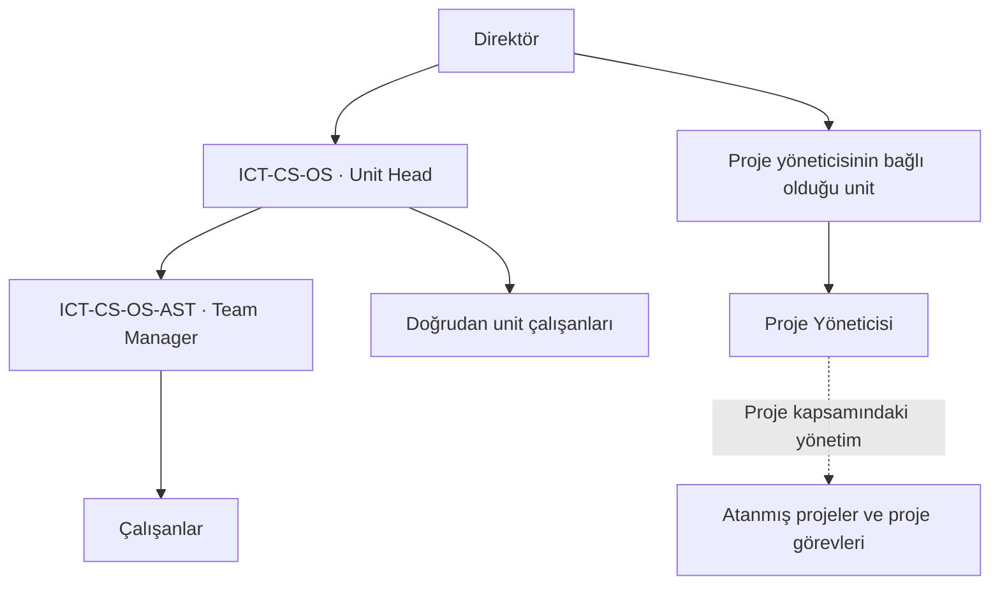
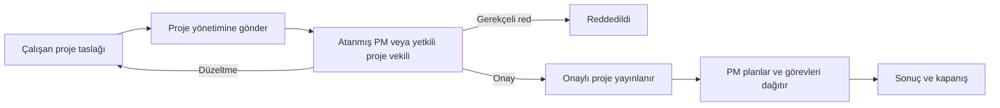

# onecs — Siber Güvenlik Yönetim Platformu Uygulama Planı

18 Kasım 2026 · Revizyon 4 · Onaylı ürün planı. Geliştirme başlamıştır; çalışan sürümün kapsamı [README](../README.md), doğrulama sonuçları [QA Raporu](QA_REPORT.md) içindedir.

Bu plan yaklaşık **200 kişi, 1 direktör ve 10–15 unit head** bulunan organizasyonda üç ayrı yönetim alanını birleştirir: **proje yöneticisinin yönettiği projeler, organizasyon yöneticilerinin dağıttığı işler ve unit head tarafından açılan vakalar**. Çalışan ilerlemesini bir kez girer; yetkili yöneticiler aynı kayıtlardan güncel durumu ve haftalık raporu görür. Ekiplerin birbirini tanıması ve çalışmalarından haberdar olması, paylaşılabilir içerikle beslenen **CS’de Neler Oluyor?** alanıyla desteklenir.

Teknik tasarım, veri modeli ve erişim kuralları [Mimari Tasarım](MIMARI_TASARIM.md) belgesindedir. Bu iki belge güncel kapsamı birlikte tanımlar. Hedefler ile uygulanmış kapsam ayrıdır; çalışan özellikler ve gerçek test kanıtları README ve QA raporuyla doğrulanır. Yardımcı iş kuralı, güvenlik ve test Markdown belgeleri `docs/` altında tutulur; AI araçlarına ait yönergeler kendi ana dizinlerinde kalır.

## 1 Ürün hedefi ve kabul edilen kararlar

18 Kasım ek kapsamı: proje talebi, iş/alt iş, vaka/ihbar, anons, paylaşım, etkinlik ve sertifika oluştururken seçili kişilere isteğe bağlı e-posta ve dosya/fotoğraf ekleme uygulanmıştır. Taslak proje başvuruda, anons/paylaşım yayında bildirim üretir; alıcı seçimi kayıt erişimini genişletmez. SMTP teslimi ve üretim tarayıcısı kurum pilotunda ayrıca doğrulanır. [Uygulanan sözleşme](services/RECORD_EXTRAS.md).

Ürün, yöneticinin **ne önemli, kim sorumlu, ne bekleniyor, ne zaman bitecek ve benden hangi karar gerekiyor** sorularına hızlı cevap verir. Ekipler açısından da doğru kişiyi bulmayı, yardım istemeyi ve yapılan çalışmayı görünür kılmayı kolaylaştırır.

| Alan | Güncel karar |
| --- | --- |
| Proje yönetimi | Projeyi atanmış Proje Yöneticisi yönetir. Proje yöneticisinin bağlı olduğu Unit Head ve kapsamlı yetki verdiği kişiler de yönetebilir. Diğer Unit Head’ler kendi organizasyon rollerinden dolayı proje yönetim hakkı kazanmaz. |
| İşler ve taahhütler | Organizasyon kapsamıyla yönetilir. Unit Head altındaki Team Manager ve çalışanlara, Team Manager kendi altına iş atar; çalışan kendisine iş açabilir. |
| Vakalar | Unit Head açar ve kritiklik/SLA seçer. Direktör direktörlük kapsamında açabilir; Team Manager ancak açık vaka açma yetkisiyle açar. Çalışan vaka bildirimi yapabilir. |
| SLA | Kritik 24 saat, yüksek 7 takvim günü, normal 1 takvim ayı değiştirilebilir başlangıç seçenekleridir. Kurumun evrensel veya resmî standardı olduğu iddia edilmez. |
| Rapor ve AI | “Rapora ekle” ve kaynak bağlantılı AI haftalık özet ilk sürümdedir. Kesin hesap, atama, onay ve yayın uygulama kurallarında kalır. |
| Yönetici sadeliği | Direktör ilk ekranda dört kart ve kısa gündem görür. Organizasyon ağacı ayrıntıya inmek içindir. |
| Onaylar | Çalışan proje başvurusu onaylanır; rutin ilerleme ve politika sınırındaki küçük değişiklikler yeniden onay beklemez. |
| Asgari kapsam | Kişisel sertifika/yetkinlik kaydı, yaklaşan bitişler ve kontrollü salt okunur API/OpenAPI ilk sürümde korunur. |
| Ekipler arası kaynaşma | Ekip profilleri, paylaşılabilir çalışma kartları, uzmanlık ve yardım noktaları, mevcut etkinliklere bağlı buluşmalar eklenir. |
| Teknik temel | React/TypeScript, Django/DRF, PostgreSQL ve kalıcı arka plan işleri kullanan modüler monolit korunur. |

Bu revizyon tam ürünün geliştirme temelidir. Üç saatlik hackathon teslimi ayrıca dar bir gösterim profili olarak ele alınır; bütün Revizyon 3 kapsamının üç saatte tamamlanacağı vaat edilmez.

## 2 Organizasyon ve proje yetkisinin ayrılması

### 2.1 Organizasyon ağacı

`ICT-CS-OS` bir unit, `ICT-CS-OS-AST` bu unitin ekibidir. Her dalda Team Manager bulunmak zorunda değildir. Alt ekipler ve birden fazla yönetim kapsamı desteklenir. Kurum kodları etiket ve arama bilgisidir; kodda tire saymak veya önek eşleştirmek yetki kuralı değildir.

**Organizasyon yöneticisi**, kendi dalının personelini ve unit işlerini yönetir. **Proje Yöneticisi**, açıkça atandığı projeleri yönetir. Bir kişinin iki rolü de olabilir; hangi kayıtta hangi yetkiyi kullandığı belirgindir. Proje Yöneticisi ile teknik iş paketi lideri aynı kavram değildir. Proje yöneticisi varsayılan tek hesap verebilir proje sahibidir; teknik lider gerekirse sınırlı bir proje görevi üstlenir.

### 2.2 Roller ve kapsam

| Rol | Temel sorumluluk |
| --- | --- |
| Çalışan | Proje taslağı oluşturur ve proje yönetimine gönderir; kendine unit işi açar; atandığı işleri ve katkılarını günceller; etkinliklere katılır. |
| Team Manager | Kendi ekip/alt ekibinde iş ve alt iş atar; yönetici işlerinde SLA seçer; personel görevlendirmesini değerlendirir; açık yetki varsa vaka açar. |
| Unit Head | Unit işleri, taahhütleri, vakaları, personel tahsisi, SLA istisnaları, anons ve etkinliklerden sorumludur. |
| Proje Yöneticisi | Başvuruyu inceler/onaylar; proje planı, ekip üyelikleri, proje görevleri, ilerleme, değişiklik ve kapanışı yönetir. |
| Proje yöneticisinin Unit Head’i | Bağlı proje yöneticisinin yönetim kapsamındaki projeleri yönetebilir; PM ataması, devamlılık ve gerektiğinde devralma sağlar. Her unit projesinin otomatik yöneticisi değildir. |
| Proje yetkilisi veya vekili | PM veya onun yetkili Unit Head’i tarafından verilen proje/portföy, işlem ve süre sınırında çalışır. |
| Direktör | Tüm unitlerin yönetim özetini görür; alt kademelere taahhüt açar; öncelik, çapraz unit bağımlılığı ve eskalasyonları yönetir. |
| System Admin | Teknik ayarlar ve kullanıcı/organizasyon yönetimi; üretimde iş verisi veya proje onayı için ayrıca iş yetkisi gerekir. |

PM’nin bağlı Unit Head kapsamı, PM görevlendirmesinde belirlenen yönetim birimine dayanır. PM’nin transferi veya değişimi, projelerin yetkisini sessizce yeni kişilere açmaz; devir, yeni yönetim birimi ve delegasyonlar kontrollü güncellenir. Yetki veren kişi kendi hakkını aşan bir yetki veremez. Vekâletin kapsamı, işlemleri, başlangıcı/bitişi ve iptali kayıtlıdır.

Bir projeye çalışan veren Unit Head/Team Manager, kaynak tahsisini kabul eder ve kendi çalışanının katkılarını izler. Bu hak projenin kapsamını, diğer ekiplerin işlerini veya yayın onayını yönetme hakkına dönüşmez. Gerekli geniş yetki ayrıca atanır.

Gönderilmemiş proje taslağı hazırlayana özeldir. Gönderim PM inceleme kapsamına açar; yayın onaylanan okuyucu kitlesine açar. Çalışanın sıradan yönetici zinciri taslağa veya bütün projeye otomatik erişim kazanmaz. Direktör yayınlanmış projelerin yönetim özetini görebilir. Katkı geçmişini okumak, başkası adına katkı yazma hakkı vermez.

## 3 Arayüz ve direktör görünümü

### 3.1 Sade açılış

Direktör ana ekranında **Kritik gündem, Geciken taahhüt ve SLA, Kararım bekleniyor, Yaklaşan önemli sertifikalar** kartları bulunur. Altında en fazla beş öncelikli konu ile anonslar yer alır. 18 Kasım 2026 arayüz düzenlemesiyle “Bu hafta ne değişti?” kutusu kaldırılmıştır; gündem kartı anons yüksekliğine uzatılmaz. Haftalık rapora üstteki bağlantıdan erişilir. Haftalık rapor düğmesi seçilmiş aday sayısını gösterir. Anonslar ve CS’de Neler Oluyor alanı ikincil bölümde görünür; acil gündemi aşağı itmez.

Her kartın kısa içeriği: **iş etkisi, sahip, yapılan, sonraki adım, termin/SLA, beklenen karar ve son güncelleme**. “Neden burada?” açıklaması kritik, gecikmiş veya karar bekleyen işaretinin nedenini gösterir. Kaynağı eski olan kayıt ayrıca işaretlenir.

Kendi işlemi sonrası ekran hemen yenilenir; başka kullanıcıların değişiklikleri ilk sürümde kontrollü polling ile, pilotta gerekirse yetkili SSE ile taşınır. Son güncelleme zamanı görünürdür. Harf yazıldıkça arama önerisi sunulur; sunucu araması bekletme/iptal/sınırlarla gereksiz yük oluşturmaz. Hiçbir arama için AI çağrısı gerekmez.

### 3.2 Menü ve görünüm

Birincil alanlar **Dashboard, Projeler, İşler ve Taahhütler, Vakalar, Raporlar** olur. **Organizasyon ve Ekipleri Tanı, Anonslar, Etkinlikler, Sertifikalar** destek alanlarıdır. **Ayarlar** yalnız yetkililere görünür. Onaylar ayrı zorunlu menü yerine üst çubukta ve ilgili modülde ortak bir bekleyenler kutusuyla erişilir. Menüler role göre sadeleşir.

**Bana Atananlar** çalışan için farklı bağlamlardaki işleri birlikte gösterir. Kayıtta Unit işi / Proje görevi / Vaka aksiyonu türü görünür. Aynı veriyi birlikte listelemek, yönetim yetkilerini birleştirmez.

Üç etkileşim hedefi statü güncelleme, kişiye atama, rapora ekleme ve hazır raporu indirme gibi sık işlemler için geçerlidir. Yeni proje içeriğini yazma veya entegrasyon kurulumuna üç tık vaadi verilmez. Sürükle bırak işlemlerinin menü/klavye alternatifi bulunur.

### 3.3 Organizasyon ayrıntısı

Direktör ilk düzeyde 10–15 unit satırını görür. Satırda unit adı/kodu, Unit Head, çalışan sayısı, unit işleri, açık vaka, SLA ihlali ve **katkı verilen projeler** bulunur. PM biriminin portföyü ayrıca “Yönetilen projeler” olarak etiketlenir; çalışan veren unit projeyi yönetiyor gibi gösterilmez.

Dal açılınca ekipler, Team Manager ve çalışanlar görünür. Sağ panelde Özet / Çalışanlar / İşler / Proje Katkıları / Vakalar / Hareketler sekmeleri vardır. Kişi ayrıntısında yalnız okuyucunun yetkili olduğu görev ve katkılar gösterilir. Ekipleri Tanı profilleri ise tüm CS için onaylanmış daha dar tanıtım bilgisidir.

Arama yetkili kişiyi/birimi ve erişilebilir yolunu açar. 200 kişinin bütün dalları aynı anda açılmaz. Klavye ve ekran okuyucu desteği sağlanır. [W3C Tree View Pattern](https://www.w3.org/WAI/ARIA/apg/patterns/treeview/)

Ortak proje direktör toplamında kimlik başına bir kez sayılır. Üst taahhüt ve alt iş ayrı kayıt olduğundan iş sayıları tür kırılımıyla sunulur. Katkı sayısından çalışan performans puanı veya sıralama üretilmez.

## 4 Projeler

### 4.1 Başvuru ve proje yöneticisi onayı

Başlık, amaç/beklenen çıktı, talep eden birim, hazırlayan, önerilen tarih, öncelik, yapılanlar/sonraki adımlar ve varsa ilk görevler girilir. **Talep eden iş birimi ile projeyi yöneten PM ve PM’nin bağlı olduğu birim ayrı alanlardır.** Çalışan otomatik PM olmaz; mevcut PM portföyü/yönlendirme kuralına göre sorumlu PM belirlenir.

Gönderim, çalışanın en yakın Unit Head/Team Manager onayına otomatik gitmez. Atanmış PM veya açıkça yetkilendirilmiş proje onaylayıcısı inceler. PM’nin bağlı Unit Head’i de bu kapsamda onaylayabilir. PM bulunamıyorsa ilgili proje yönetim sorumlusuna “Yönlendirme gerekiyor” kaydı düşer; başvuru sahipsiz yayınlanmaz.

Tek geçerli yayın onayı yeterlidir. Proje onaylanınca belirlenen ekip/proje okuyucularının açık proje listesinde yayınlanır. Her yönetim katmanından sırayla imza beklenmez. Başvuran aynı zamanda PM/onaylayıcıysa kendi başvurusunu normal onay işlemiyle onaylayamaz; PM’nin Unit Head’i veya uygun vekili karar verir. Bu kontrol rol adına değil gerçek kullanıcı kimliğine uygulanır: aynı kişi hem PM hem ilgili Unit Head olduğunda rol değiştirmek engeli aşmaz. Uygun bağımsız yetkili yoksa başvuru yeniden yönlendirilir.

Direktörün başlattığı bir proje için kurum isterse **doğrudan proje başlatma** yetkisi tanımlar. Bu işlem ayrı kayıtlı yetkidir; kendi kendine onay verilmiş gibi gösterilmez. PM ataması ve yayın kapsamı yine zorunludur. Varsayılan çalışan başvuru akışı her durumda onaylıdır; System Admin iş onaylayıcısı olmaz.

Onay durumu Taslak / Onay Bekliyor / Düzeltme İstendi / Onaylandı / Reddedildi / Geri Çekildi; yürütme durumu Planlandı / Devam Ediyor / Beklemede / Tamamlandı / İptal alanlarıdır. Onay bekleyen proje açık proje sayısına katılmaz.

### 4.2 Kaynak tahsisi ve görevler

PM kabul edilmiş proje üyelerini ve proje içindeki görevlerini yönetir. Bir unitten yeni çalışan görevlendirmesi istenirse o kişinin kaynak yöneticisi kabul eder; bu karar **personel tahsisidir**, projenin içerik onayı değildir. Kabul beklerken PM planında bağımlılık görünür. Onaylı tahsis sınırını aşan çalışma veya yeni kişi için yeni talep gerekir.

Proje görevinin sorumlusu, tarihi, ilerlemesi ve varsa teknik lideri PM tarafından belirlenir. Diğer Unit Head’ler kendi unitlerinin yöneticisi oldukları için proje görevlerinin tarih/statüsünü keyfî değiştiremez. Çalışan kendisine verilen görevin ilerlemesini günceller; yetki ayrımı mimaride context bazında uygulanır.

### 4.3 Değişiklik ve kapanış

Rutin ilerleme, katkı ve görev statüsü yeniden yayın onayına girmez. PM, tanımlı tolerans içinde ve dış taahhüdü etkilemeyen küçük görev tarihi değişikliklerini gerekçesiyle doğrudan yapabilir. Tolerans ve önemli değişiklik ölçütleri ayarlanabilir; başlangıçta dış taahhüt tarihini veya ana amacı değiştiren işlem önemli kabul edilir.

Amaç/ana kapsam, kaynak taahhüdü, bütçe etkisi veya okuyucu kitlesini genişletme önemli değişikliktir; belirlenmiş proje karar sahibine gider. Erişimi daraltma güvenlik işlemi onay beklemeden yetkili kişi tarafından uygulanır. Onay bekleyen yeni sürüm mevcut yayınlanmış sürümü sessizce değiştirmez.

PM kapanış özetini, açık işleri ve teslim kanıtını tamamlar. Zorunlu işler bitmeden proje kapanmaz. Normal kapanış PM yetkisinde sonuç kaydıyla yapılabilir; kritik/denetime tabi projelerde bağımsız doğrulayıcı zorunluluğu proje politikasıyla etkinleştirilir. İstisna veya risk kabulü kurumun ayrı yetkisini gerektirir.

MVP ilerleme yüzdesi **PM’nin beyanı + gerekçe + güncelleme zamanı** şeklindedir. Görev kapanma oranı ayrı ölçüdür. Revizyon 4 ile ağırlıklı ekip/teslimat ölçümü ayrı bir gösterge olarak eklenmiştir. Gerçek snapshot geçmişi görüntülenir; aylık geçmişin geriye dönük yeniden inşası sonraki fazdır. Farklı ilerleme yöntemleri aynı ölçüymüş gibi karşılaştırılmaz.

## 5 Unit işleri ve taahhütler

### 5.1 Yönetim sınırı

İşler ve Taahhütler modülünün varsayılan konusu **unitin günlük işleri ve yönetim taahhütleridir**. Proje görevleri Projeler, vaka aksiyonları Vakalar içinde yönetilir. Teknik olarak ortak iş modeli kullanılabilir; kayıt türü ve yetki politikası ayrıdır.

| Atayan | Unit işi atama kapsamı |
| --- | --- |
| Direktör | Altındaki Unit Head, Team Manager ve çalışanlar |
| Unit Head | Kendi unitindeki yöneticiler ve çalışanlar |
| Team Manager | Kendi ekibi ve alt ekipleri |
| Çalışan | Kendisi |
| Yalnız Proje Yöneticisi rolü olan kişi | Unit işi için ek yetki sağlamaz; kendi projelerindeki görevleri yönetir. |

Yönetici atamada beklenen çıktı, sorumlu, kritiklik/SLA ve gerekirse açıklama girer. Kişinin rol adı değil, etkin kullanıcı kimliği atanır. Başka unitin çalışanı için ilgili kaynak yöneticisinin kabulü gerekir. Direktörün tüm alt kapsamı içindeki yetkili ataması korunur.

### 5.2 Alt işler ve sorumluluk

Direktör Unit Head’e taahhüt açar; Unit Head Team Manager’a, Team Manager çalışanlara alt işler oluşturur. Her alt işin tek sorumlusu ve termini vardır. Üst taahhüdün sorumlusu, alt iş açıldığı için değişmez. Üst işin sahibi bütün sonucu teslim etmekten sorumludur.

Açık zorunlu alt işler üst işin tamamlanmasını engeller. Alt işlerin bitmesi üst taahhüdü otomatik tamamlamaz; üst sorumlu sonuç kaydeder. Alt termin üst tarihten sonraysa görünür uyumsuzluk çıkar; üst tarih kendiliğinden uzamaz. Aynı iş ağacında döngü oluşturulamaz.

Alt işi gören çalışan üst taahhüdün özel içeriğini otomatik görmez. Alt işe bilinçli eklenen paylaşılabilir hedef özeti gösterilir. Alt iş açma, yeniden atama ve üst sorumluluğu devretme ayrı işlemlerdir.

### 5.3 Çalışanın kendine açtığı iş

Çalışan kendine günlük iş/backlog kaydı açabilir; kişisel öncelik ve hedef tarih belirleyebilir. Bu alanlar **yönetim tarafından verilmiş SLA taahhüdü değildir**. Yönetici işi resmî takibe aldığında veya atama yaparak benimsediğinde kritiklik/SLA seçer; SLA bu yönetici işleminin kaydedildiği anda başlar. Önceki kişisel hedef ve katkılar korunur.

Yönetici çalışan rolüyle kendine kişisel kayıt da açabilir. Arayüzde “Kişisel iş” veya “Yönetim taahhüdü” işlem türü belirgindir; resmî taahhüt seçimi ilgili yetkiyi ve zorunlu alanları gerektirir. Zaten resmî olmuş bir iş sonradan kişisel etikete çevrilerek SLA’dan kaçırılamaz.

### 5.4 Durum ve bildirim

Durumlar Backlog / Açık / Devam Ediyor / Beklemede / Doğrulama Bekliyor / Tamamlandı / İptal olur. Kişisel işi kullanıcı doğrudan tamamlar. Resmî unit işi/taahhütte sorumlu sonuç kaydederek tamamlanma bildirir; atayan yönetici veya yetkili iş karar sahibi kabul edince iş tamamlanır ve SLA durur. Sorumlu ile kabul eden aynı gerçek kişiyse uygun üst/vekil karar verir. Doğrulama beklerken SLA devam eder; yönetici kabulü tek hızlı aksiyonla yapar. Rutin ilerleme güncellemeleri onay beklemez. Gecikme ve SLA ihlali tarihten hesaplanır. Beklemede açıklama, tamamlamada sonuç istenir. Tarihsiz kişisel backlog gecikmiş sayılmaz.

Başkasına yeni atama ve yeniden atamada **uygulama içi bildirim ve e-posta** yeni sorumluya gönderilir. Alt işler de aynı davranır. Kişinin kendine oluşturduğu iş için e-posta varsayılan gönderilmez. Atama ve bildirim niyeti birlikte kaydedilir; posta kesintisinde iş kaybolmaz. Bekliyor / Posta servisine iletildi / Başarısız / Teslim belirsiz durumları görünürdür. Servisin kabulü okunma bilgisi sayılmaz.

Mesaj kısa ve giriş gerektiren bağlantılıdır; hassas vaka/proje ayrıntısı kopyalanmaz. Kuyrukta eski atama iptal edilmişse eski alıcıya gönderim durur. Eksik posta adresi işi geri almaz; atayana uyarı çıkar. Demo için gerçek test posta kutusu kullanılır.

## 6 Vakalar

Resmî vaka açma varsayılan yetkisi **Unit Head**’dedir. Direktör kapsamı içinde açabilir. Team Manager yalnız açık `vaka oluştur` yetkisi/vekâletiyle açar. Çalışan **vaka bildirimi** hazırlayıp yetkili yöneticisine iletebilir; bu bildirim resmî vaka veya başlamış vaka SLA’sı olarak sayılmaz. Acil güvenlik olayı mevcut olay müdahale kanalına hemen aktarılır; dashboard onayı beklenerek müdahale geciktirilmez.

Unit Head’in vaka açması kabul edilen gereksinimdir; Direktör/Team Manager istisnaları ve çalışan bildirimi yukarıdaki akışı tamamlayan önerilen varsayılanlardır. Gerçek kullanıma geçerken kurumun vaka yetki politikasıyla kesinleştirilir.

Vaka türleri Güvenlik Olayı / Zafiyet Takibi / Operasyonel Sorun ayrılır. Kayıtta kaynak referansı, paylaşılabilir sistem/varlık özeti, sahibi unit, koordinatör, katılan ekipler, önem, SLA, yapılanlar ve sonraki adımlar bulunur. Unit Head açılışta koordinatör seçer veya geçici sorumluluğu üstlenir.

Durum akışı **Yeni → Değerlendiriliyor → İşlemde → Doğrulama Bekliyor → Kapandı** olur. Engel ayrı açıklamadır. İptal/mükerrer gerekçe ve varsa asıl vaka bağlantısı ister. Proje yayın onayı vaka açılışına uygulanmaz.

Tek vakada CDC, OffSec, IAM ve Firewall için farklı aksiyonlar açılır. Her aksiyonun sorumlusu ve sonraki adımı görünür. Başka unitin personeli için kabul edilmiş görevlendirme kullanılır; kabul bekleyen talep vaka SLA’sını durdurmaz. Vaka koordinatörü kabul edilmiş kişilere vaka aksiyonu dağıtır; unitteki diğer işleri yönetme hakkı kazanmaz.

Koordinatör kapanış ister; atanmış yetkili doğrulayıcı sonuç/kanıt ve zorunlu aksiyonları kontrol eder. Koordinatör ile doğrulayıcı aynıysa uygun bağımsız yetkili atanır. Açık zorunlu aksiyon varken kapatılamaz. Uzun vadeli iyileştirme farklı iş/projeye aktarılırsa gerekçe ve bağlantı korunur; zorunluluk sessizce silinmez. Teknik risk kabul yetkisi bu ürün tarafından verilmez.

Vaka okuyucuları koordinatör, kabul edilmiş katılımcılar ve ilgili yönetim kapsamıdır. Bir unitin katılması bütün çalışanlarını otomatik okuyucu yapmaz. Ortak koordinasyon özeti dashboard’da; hassas teknik kanıt kaynak sistemin kendi izinlerinde tutulur. Olay iletişimini ve yönetimi ilişkilendiren kaynak: [NIST SP 800-61r3](https://csrc.nist.gov/pubs/sp/800/61/r3/final).

## 7 Ayarlanabilir SLA ve eskalasyon

### 7.1 Başlangıç seçenekleri

| Kritiklik | Başlangıç tamamlama hedefi | Açıklama |
| --- | --- | --- |
| Kritik / Acil | 24 saat | Açılış/atama anından geçen 24 saat. |
| Yüksek | 7 takvim günü | Hafta sonu dahil 7 gün. |
| Normal | 1 takvim ayı | Takvimde bir sonraki ay; aynı gün yoksa ayın son gününe kırpılır. |

Bunlar kullanıcı talebini somutlaştıran **başlangıç ürün ayarlarıdır**. Adlar, süreler ve izinli istisnalar Ayarlar → SLA Politikaları ekranından değiştirilebilir. “1 ay” sessizce 30 güne çevrilmez. İlk sürüm 7/24 geçen süre/takvim mantığını kullanır; mesai, tatil ve duraklama takvimi sonraki geliştirmedir ve etkinleşmeden vaat edilmez.

Bu SLA **iç koordinasyon/tamamlama hedefidir**. Güvenlik olayındaki ilk yanıt, müdahale ve kontrol altına alma süreleri ayrı kurumsal hedeflerdir. Kritik olayın müdahalesinin 24 saat bekleyebileceği anlamına gelmez; gerekiyorsa daha kısa ayrı hedefler tanımlanır.

### 7.2 Başlangıç ve bitiş

| Kayıt | SLA başlangıcı | SLA bitişi |
| --- | --- | --- |
| Resmî vaka | Unit Head/yetkili kişinin resmî vaka kaydını kaydettiği an | Doğrulanmış kapanış |
| Yönetici tarafından açılan unit işi/taahhüt | İlk etkin atamanın kaydedildiği an | Atayan yönetici/yetkili iş karar sahibinin sonuç kabulü |
| Çalışanın kişisel işi | Kendiliğinden başlamaz; yönetici resmî takibe aldığında başlar | Resmî takibe alındıysa yönetici sonuç kabulü; kişisel kaldıysa SLA yok |
| Proje görevi | Otomatik unit SLA’sı yok; PM tarafından verilen termin izlenir | Proje görev kabul kuralına göre |

Taslakta veya başka unit kabulü bekleyen görev talebinde yeni iş SLA’sı başlamaz; varsa üst vaka/taahhüdün saati devam eder. Bir iş için “ilk yanıt”, “bitiş” ve kişisel hedef tarih birbirine karıştırılmaz.

Her kayıtta kullanılan politika sürümü, başlangıç, **ilk son tarih**, geçerli son tarih ve geçmiş değişiklikler saklanır. İhlal sonrasında iş kapansa da geçmiş ihlal silinmez. İptal ve mükerrer için gerekçe gerekir; bunlar zamanında tamamlandı sayılmaz ve önceki ihlali ortadan kaldırmaz.

### 7.3 Değişiklik ve bildirim kuralları

- Politika değişikliği varsayılan yeni kayıtlara uygulanır. Açık kaydı etkilemek için yetkili kişi gerekçeli yeniden planlama yapar.
- Son tarih veya kritiklik değişimi kim/ne zaman/neden bilgisiyle saklanır; ilk tarih ve oluşmuş ihlal korunur. Öncelik artırma sessizce daha ileri tarih üretmez.
- Yeniden atama, alt iş oluşturma veya aynı kaydı yeniden açma saati sıfırlamaz. Yeni olay/taahhüt gerekiyorsa önceki kayda bağlı yeni kayıt açılır.
- Beklemede ve Doğrulama Bekliyor durumları saati varsayılan durdurmaz. Duraklatma desteklenirse açık izin, neden ve zaman aralığı gerektirir; MVP’de kapalıdır.
- Kişi kendi SLA’sını uzatamaz. İşi açan yetkili yönetici veya tanımlı SLA karar sahibi değiştirir. Kendi lehine istisnada üst/vekil kararı kullanılır.
- Varsayılan uyarılar sürenin %80’i ve %100’üdür; ayarlanabilir. Aynı eşik için tekrar tekrar e-posta üretilmez.
- İhlal önce sorumlu ve ilgili yöneticisine, politika gerektiriyorsa Unit Head/direktöre yükseltilir. Her ihlal bütün CS’ye duyurulmaz.
- Sistem kesintisi saati durdurmaz. Açılışta vadesi geçmiş kayıtlar yeniden değerlendirilir; geçmiş eşiklerin mail yağmuru yerine güncel durum için tek birleştirilmiş uyarı gönderilir.

## 8 Ekipler arası kaynaşma ve bilgi paylaşımı

### 8.1 CS’de Neler Oluyor

Yeni bir büyük sosyal ağ modülü yerine üç mevcut alan birlikte kullanılır: **Dashboard’da CS’de Neler Oluyor**, **Organizasyon’da Ekipleri Tanı**, **Etkinliklerde Bilgi Paylaşım Buluşmaları**. Böylece kullanıcı ikinci kez bütün işini anlatmak zorunda kalmaz.

| İhtiyaç | Ürün karşılığı |
| --- | --- |
| “Bu ekip ne yapıyor?” | Ekip profili: sorumluluklar, destek verdiği alanlar, iletişim noktası ve paylaşılmış çalışmalar. |
| “Bu konuda kime danışabilirim?” | Kişinin gönüllü belirttiği uzmanlık alanı, yardım verebileceği konular ve ekip iletişim noktası. |
| “Diğer ekipler bu hafta ne yaptı?” | Onaylı kısa çalışma/kazanım kartları ve kaynak bağlantılı haftalık paylaşım özeti. |
| “Bizim de katkımız olabilir.” | Katkı vermek istiyorum / yardım isteği; ilgili sahibine bildirim ve normal kaynak tahsis akışı. |
| “Ekipler birbirini tanısın.” | Mevcut etkinlik modülünde kısa teknik paylaşım, ekip tanıtımı, soru-cevap veya sosyal buluşma. |

Ekip profili ilgili yöneticinin sorumluluğundadır. Kişisel uzmanlık gönüllü beyanıdır; resmî sertifika kaydıyla karıştırılmaz. Telefon/özel iletişim bilgisi yerine kurumsal iletişim ve izinli profil kullanılır. Çalışanlar tüm CS’nin ham faaliyet geçmişini görmez.

### 8.2 Paylaşım kartı

Kartta kısa başlık, “ne yaptık/ne öğrendik”, yararı, katkı veren ekipler, izin verilen kişi adları, konu etiketleri, iletişim noktası ve hedef kitle bulunur. Başarı, öğrenilen ders, yardım arayışı veya bilgi paylaşımı daveti türleri yeterlidir. Kaynak iş/proje/etkinlik bağlantısı tekrar veri girişini azaltır.

Çalışan paylaşım taslağı önerir. Unit işi/ekip kartını ilgili yetkili yönetici; proje kartının içeriğini PM veya proje yayın yetkilisi onaylar. PM rolü tek başına tüm CS’ye yayın hakkı vermez: hedef kitleyi genişletmek için ayrıca o kitleyi kapsayan paylaşım/yayın yetkisi gerekir. İçerik ve hedef kitleyi onaylama hakları aynı kişideyse tek işlemle yayınlanır; değilse yetkili yayıncıya gider. Vaka üzerinden yalnız kapanış sonrası veya açıkça uygun görülen **temizlenmiş öğrenim özeti** Unit Head onayıyla paylaşılır. Ham vaka başlığı, varlık bilgisi, kritik bulgu, kişisel veri veya canlı aksiyon akışı otomatik herkese taşınmaz.

Paylaşım metni ve hedef kitle ayrıca onaylanır. Kartı okuyabilmek kaynağı okuyabilme yetkisi vermez. Kaynak erişimi olmayan okuyucu yalnız onaylı paylaşım metnini görür; kapalı kaynak başlığı/önizlemesi döndürülmez. Kaynak sınıfı değişirse ilgili paylaşım yeniden incelenir veya geri çekilir.

Karttan “İlgileniyorum” demek proje üyeliği, iş ataması veya ekibe katılım oluşturmaz. Bildirim sahibine gider; çalışanın zamanı/kaynağı gerekiyorsa yöneticisinin normal kabulü alınır. Uzmanlık beyanı da otomatik görev atama yetkisi değildir.

### 8.3 Basit ve ölçülebilir kullanım

İlk sürüm ekip rehberi, çalışma kartı, konu/ekip filtresi ve mevcut etkinliğe yönlendirmeyi içerir. Serbest mesajlaşma, beğeni yarışması, puan/rozet ve çalışan popülerlik sıralaması eklenmez. AI daha sonra konu eşleştirmeyi önerebilir; otomatik kişisel profil çıkarmaz.

Haftalık CS özeti yalnız yayımlanmış ve okuyucunun yetkili olduğu kartlardan hazırlanır. AI kaynakları gösterir; yeni başarı veya kişi katkısı uydurması kabul edilmez ve otomatik yayın yapmaz. Yönetim raporu ile CS paylaşım özeti farklı okuyucu kapsamlarıdır; biri diğerine kopyalanmaz.

Pilot ölçümleri: doğru ekip/kişiyi bulma süresi, yardım talebine yanıt, gerçekleşen çapraz ekip buluşmaları ve gönüllü geri bildirim. Amaç kişi başına gönderi sayısını performans hedefi yapmak değildir.

## 9 Anons etkinlik ve katkı geçmişi

### 9.1 Anons

Çalışan/Team Manager önerir; Unit Head yayın kararını verir. Hedefler kendi unitim, seçili ekipler veya tüm CS olabilir. Direktör de yayınlayabilir; Team Manager’a açık vekâlet verilebilir. Tüm CS yayını alıcı ve içerik önizlemesi ister. Başlangıç/bitiş, kategori ve önem belirlenir; süresi dolan yayın arşivlenir.

Anons, çalışma kartı ve kaynak proje/vakanın erişimi ayrıdır. Etiket eklemek kaydı herkese açmaz. Hassas kaynak metni otomatik kopyalanmaz. Gönderildi, okundu ve aksiyon tamamlandı ayrı durumlardır. Atama e-postası bütün anonsların e-postalanması anlamına gelmez.

### 9.2 Etkinlik anket ve katılım

Yönetici kendi ekip/unit/direktörlük kapsamında etkinlik ve tercih anketi açar. Çapraz unit etkinliğinde ilgili yöneticilerin kabulü veya direktör kararı kullanılır. Tarih seçimi anketi, Katılacağım / Katılmayacağım / Kararsızım yanıtı ve gerçekleşmiş katılım ayrı kayıtlardır.

Tek/çok seçim, kapanış zamanı ve davetli listesi tanımlıdır. Kişinin tek etkin yanıtı vardır; kapanıştan önce değiştirebilir. Seçenek anlamı oy geldikten sonra değişmez. Davetli değişimi sürümlenir ve sonuç paydasında görünür. Yanıt vermeyen ile katılmayacağını söyleyen ayrı sayılır; çok seçim toplamı kişi sayısını aşabilir. Anket sonucu etkinliği otomatik kesinleştirmez; yönetici günü/yeri kararlaştırır.

İlk sürüm isimli ankettir: düzenleyen/yetkili yönetici isimli yanıtı, davetli kendi yanıtı ve toplu sonucu görür. Anonim geri bildirim ayrı mahremiyet tasarımı olmadan açılmaz. Yıllık takvim, galeri ve gerçek takvim entegrasyonu sonraki fazdadır; basit etkinlik kaydı bu entegrasyonların yapılmış olduğu anlamına gelmez.

### 9.3 Katkı geçmişi

İlerleme, atama, durum ve kararların gerçek yazarı/zamanı tutulur. Not düzeltilirse önceki sürüm korunur. Yöneticiler çalışan ayrıntısından yalnız yetkili katkıları görür; başka biri adına not yazamaz. Çalışan transferinde eski katkının ekip/yazar bilgisi değişmez.

Kullanıcının Hareketler görünümü ile teknik güvenlik audit’i ayrı erişime sahiptir. Parola, token, hassas metin ve posta sırrı loglara yazılmaz. Başkasını tanımayı sağlayan açık paylaşım alanı, bütün katkı geçmişinin herkese açılması değildir.

## 10 Haftalık rapor AI sertifika ve veri paylaşımı

### 10.1 Haftalık rapor ilk sürümdedir

Günlük iş güncellemesi → rapor adayı → yetkili yönetici/PM incelemesi → kaynaklı AI taslağı → onaylı sürüm → çıktı akışı uygulanır. Kullanıcı “Rapora ekle” ile seçer; kapsam içindeki kritik, SLA ihlalli/gecikmiş ve karar bekleyen kayıtlar otomatik aday olur. Bu adayları çıkarmak gerekçe ister.

Unit raporunu organizasyon yetkilisi, proje raporunu PM/proje yetkilisi, direktör raporunu tanımlı direktörlük rapor yetkilisi onaylar. Rapor yetkisi kaynak projeyi yönetme hakkı vermez. Kaynaklara erişim olmadan içerik rapora taşınmaz.

Bölümler Yapılanlar / Kritik konular / Engeller ve gecikmeler / Karar ihtiyaçları / Sonraki adımlar olur. Her önemli madde kaynak ID/sürümü ve veri kesim zamanına bağlanır. Sayı/tarih/yüzde SQL ve kanonik veriden gelir. Onay görülen içerik, kaynak listesi, hedef kitle ve sürüme bağlanır; ekranda açıkken değişen taslak sessizce onaylanamaz.

İlk sürüm gerçek model çağrısı, Markdown ve yazdırılabilir çıktı içerir; sunucu PDF’i pilotta sağlamlaştırılır. AI bağlantısı yoksa açıkça belirtilen kurallı rapor çalışır. Önceden yazılmış metin canlı AI gibi gösterilmez. Hazır raporun yeniden açılması yeni model çağrısı yapmaz.

Rapor ayrıntısı modal içinde Genel Rapor ve ekip bazlı pivot görünümünü birlikte sunar. Genel Rapor ilk sekme/satırdır; ekip seçimi raporun kayıtlı ve halen erişilebilen kaynaklarını bölüm bölüm gösterir. Sayılar AI tarafından üretilmez; raporu açmak yeni model çağrısı başlatmaz. Ekip etiketi yeni raporlarda snapshot ile korunur; eski raporlardaki güncel organizasyon çözümü ayrıca belirtilir. [Rapor/pivot sözleşmesi](services/REPORTING.md).

### 10.2 Düşük token ve güvenilir AI

Yalnız değişen kayıtların kısa özetleri üretilir; önce açık proje/vaka ilişkileri kullanılır. Aynı kaynak/ACL/model/prompt sürümünde sonuç önbelleği kullanılır. Her sayfa/harf için çağrı yapılmaz. Çıktı, aday sayısı, yeniden deneme ve günlük/aylık maliyet limiti vardır.

Kaynak metni talimat değildir. Model atama, izin, kritiklik/SLA veya yayın değiştiremez. Yanlış ID/şema ve doğrulanamayan kesin alanlar reddedilir; anlatım insan incelemesinden geçer. Yetki girdi hazırlanırken ve geç dönen sonuç kaydedilirken tekrar kontrol edilir. Erişimi kaldırılan eski sonuç cache’i yeniden dolduramaz.

AI sekmesinde sağlayıcı/model, bağlantı testi, veri sınıfı, prompt sürümü, limit, tarih/ekip/işlev bazında token ve hesaplanan maliyet gösterilir. Kullanımı bilinmeyen timeout sıfır tüketim sayılmaz. Tahmini kullanım ve sağlayıcı sayacı ayrılır; fiyat tarifesi tarihli ve sürümlüdür. Uzak sağlayıcıya gönderilebilecek veri kurum politikasına bağlıdır.

### 10.3 Sertifikalar ve API

İlk sürüm kişisel sertifika/yetkinlik kaydı: kişi, ekip, veren kurum, ad, alınma/bitiş, süresiz durumu, önemli işareti ve beyan/doğrulama durumu. Süre yaklaşma eşikleri ayarlanır; bildirimler tekilleştirilir. Güvenli belge yükleme, kurumsal sertifika ve denetim paketi pilot/genişlemededir. Ekip rehberindeki gönüllü uzmanlık beyanı resmî sertifika sayılmaz.

Kontrollü salt okunur dış API ilk sürümdedir; kısa ömürlü JWT bearer, scope ve kayıt yetkisiyle çalışır. OpenAPI/Swagger Ayarlar API sekmesinden erişilir. API’ye izin vermek tüm CS verisini açmaz. MCP daha sonraki adaptördür; aynı servis/policy’yi kullanır.

## 11 Ayarlar ve test ortamı

İlk sürümde gerçekten uygulanacak sekmeler: Kullanıcılar/Roller ve Organizasyon, Proje Yetkileri, SLA Politikaları, E-posta, AI, API/OpenAPI, Günlükler ve İş Kuyruğu. Model/posta bağlantısı test edilir; sırlar kaydedildikten sonra okunamaz. LDAP, Teams ve gelişmiş saklama/dosya sekmeleri ilgili entegrasyon hazır olduğunda etkinleşir; boş ekran hazır özellik diye gösterilmez.

**18 Kasım kullanıcı kararı:** LDAP kullanıcısı önceden elle içeri aktarılmadan giriş yapabilmelidir. Başarılı kişisel LDAP doğrulaması sonrasında hesap ve grup temelli ekip/rol eşlemesi otomatik oluşturulur. Tam organizasyon grubu çalışan kapsamını verir; yönetici rolleri açık ve yetkili grup–rol politikasıyla belirlenir. İsim/e-posta ile yerel hesap birleştirilmez; proje ve vaka yetki sınırları korunur.

Lokal sistem hesabı ve güvenli LDAP/AD girişi hedef ürün gereksinimidir; gerçek LDAP bağlantısı pilot kabulünde tamamlanır. Kurumsal SSO ek seçenek olabilir, LDAP gereksinimini sessizce kaldırmaz. Tarayıcı güvenli sunucu oturumu/CSRF; dış API JWT kullanır. Bootstrap anahtarları ve DB ilk bağlantısı deployment katmanında kalır; işletim ayarları UI’dan yönetilir.

System Admin’in God Mode’u yalnız sentetik test ortamındadır. Üretimde sunucu/başlangıç kontrolüyle engellenir. “Bu kullanıcı gibi gör” modunda admin bypass’ı kapanır; gerçek aktör ve denenen kullanıcı ayrı audit edilir. Bozuk durum/çift oy gibi iş kuralları testte de korunur. Bu özellik gerçek rol oturumlarıyla yapılacak negatif testlerin yerine geçmez.

## 12 Geliştirme sırası ve teslim kapsamı

### 12.1 İş paketleri

| Paket | Çıktı | Tamamlanma kanıtı |
| --- | --- | --- |
| M1 Kimlik organizasyon ve yetki | Lokal login, ağaç, PM kapsamı/delegasyon, policy, sade arayüz kabuğu, temel ayarlar | Unit yöneticisi ve PM sınırları gerçek rol oturumlarında ayrılır. |
| M2 İş taahhüt ve SLA | Unit işi, kişisel iş, alt iş, katkı, politika sürümü, SLA, outbox/mail | Üst sorumluluk korunur; SLA kesintiden etkilenmez; test kutusuna mail gider. |
| M3 Projeler | Çalışan taslağı, PM onayı, kaynak tahsisi, görev ve değişiklik kuralları | Sıradan Unit Head projeyi yönetemez; PM/bağlı Unit Head/yetkilisi yönetebilir. |
| M4 Vakalar | Yetkili açılış, kritiklik/SLA, ekip aksiyonları ve kapanış | Tek vakada çoklu unit, doğrulama ve zamanında/ihlal ayrımı. |
| M5 Rapor AI ve asgari veri paylaşımı | Seçki, kaynaklı gerçek AI taslağı, kullanım ekranı, read-only API/Swagger, sertifika | Yetkili rapor ve API; token limiti, AI’sız devam, sertifika uyarısı. |
| M6 Ekipleri tanı ve iletişim | Ekip profilleri, onaylı paylaşım kartları, anons, etkinlik anketi/katılımı | Çapraz ekip keşfi; kaynak gizliliği korunarak paylaşım; doğru katılım sayısı. |
| M7 Pilot sağlamlaştırma | Gerçek LDAP, restore, kesinti, güvenli dosya, gerçek organizasyon, Teams ve performans ölçümü | Pilot kabul koşulları ve işletim sahipleri tamamlanır. |

Sıra bağımlılıkları gösterir; arayüz, doküman ve testler her paketle birlikte yapılır. Rapor seçkisi iş kayıtlarıyla birlikte başlar. M5 ürünün ilk tesliminden çıkarılacak opsiyonel süs değildir. Süre tahmini ekip/ortam/erişim doğrulanınca yapılır; kararlı sürüm için bütün paketleri aynı anda başlatmak yerine çalışan akışlar kademeli birleştirilir.

### 12.2 Hackathon gösterim profili

Hackathon için sentetik küçük veriyle lokal login, temel rol/PM ayrımı, iş atama, tek vaka/SLA, çalışan proje başvurusu ve PM onayı, kaynaklı AI rapor, uygulama içi bildirim, basit etkinlik/kişisel sertifika ve salt okunur API gösterilir. Gerçek test e-postası erişim hazırsa eklenir; yerel posta yakalayıcı kullanılırsa kurum mail entegrasyonu tamamlandı denmez. Kapsam süreye sığmıyorsa ekipçe erken daraltılır; yapılmayan özellik çalışıyormuş gibi sunulmaz.

Tam Revizyon 3 ile hackathon gösterim profili aynı tamamlanmışlık iddiasını taşımaz. Yarışmanın kod teslim, süre ve canlı demo kuralları ayrı teslim kontrol listesinde korunur. Kurumsal üretim güvenliği için pilot kapısı gerekir.

### 12.3 Sonraki fazlarda korunan ihtiyaçlar

Ağırlıklı proje kilometre taşları, aylık snapshot/PDF/PPTX, Teams/takvim, kaynak sistem adaptörleri ve MCP operasyonel genişlemedir. Ürün/lisans yenileme, bütçe, denetim kanıt paketi ve galeri ek yönetim modülleridir. Anonim geri bildirim ayrı mahremiyet hattıdır. Bu ihtiyaçlar iptal edilmemiştir.

AI ile geliştirme kanıtı ile ürünün AI özelliği ayrıdır. Gerçek araç/istem, görev devri, commit, bağımsız inceleme ve test çıktıları güvenli biçimde kayıt altına alınır; sahte geçmiş üretilmez. README, proje belgesi, akış/servis Markdown dosyaları, AGENTS.md, SECURITY.md, ilgili SKILL.md’ler, API şeması ve test izlenebilirliği geliştirmeyle birlikte hazırlanır. Mevcut aşamada bunlar planlanan çıktılardır.

## 13 Kabul senaryoları

**40 kabul senaryosu** geliştirme sırasında uygulanacak doğrulamaları tanımlar; çalıştırılmış test veya başarı sonucu değildir. K01–K22 önceki kapsamın güncellenmiş karşılıklarıdır; yeni davranışlar K23–K40’a eklenmiştir.

| ID | Senaryo | Beklenen sonuç |
| --- | --- | --- |
| K01 | Sentetik 200 kişi/12 unitte Director, UH, TM ve çalışan girişleri | Doğru dallar, doğrudan unit çalışanı ve ICT-CS-OS/AST ayrımı; kod değişimi yetkiyi değiştirmez. |
| K02 | Çalışan proje taslağı kaydeder ve gönderir | Taslak kişisel; gönderim atanmış PM’ye gider, normal yöneticisi otomatik onaylayıcı olmaz. |
| K03 | PM düzeltme ister; çalışan yeniden gönderir; PM onaylar | Gerekçeli sürümler korunur; tek onaylı proje yayınlanır. |
| K04 | PM kendi başvurusunu onaylar; aynı kişi PM ve ilgili UH rollerini taşır; direktör ayrı başlatma yetkisini kullanır | Gerçek kimliğe göre kendi onayı reddedilir; rol değişimi aşamaz; tanımlı doğrudan başlatma ayrı audit ve PM atamasıyla çalışır. |
| K05 | PM, PM’nin UH’si, süreli proje yetkilisi ve başka UH aynı projeyi yönetmeyi dener | Yalnız proje yönetim kapsamındaki izinler çalışır; diğer UH’nin okuması yazma hakkı vermez. |
| K06 | Katkı girilir/düzeltilir; çalışan ayrıntısından okunur | Gerçek yazar, o tarihteki ekip ve eski sürüm korunur; yalnız yetkili içerik görünür. |
| K07 | UNIT_WORK, PROJECT_TASK ve CASE_ACTION farklı ekranlardan açılır | Tek kayıt; ayrı policy; Bana Atananlar birleşimi yönetim hakkını genişletmez. |
| K08 | UH resmî vaka açar; çalışan bildirim yapar; yetkisiz TM vaka açmayı dener | Bildirim resmî vaka sayılmaz; açılış yetkili; zorunlu aksiyon/doğrulama olmadan kapanmaz. |
| K09 | UH tüm CS’ye ve seçilen unitlere anons yayınlar | Yalnız hedef kitle; bağlı kaynak erişimi genişlemez; süresi dolan yayın arşivlenir. |
| K10 | Oy değişir, çift istek gelir ve kapanışla yarışır | Tek etkin yanıt; kapalı ankette değişiklik yok; doğru payda. |
| K11 | Tercih anketi, RSVP ve gerçekleşen katılım kaydedilir | Üçü ayrı; yanıtsız/kararsız/katılmayacak ayrılır. |
| K12 | Aynı proje iki unit katkı listesinde yer alır | Direktör toplamı tekil; yöneten portföy ve katkı veren unit ayrılır. |
| K13 | Kullanıcı transfer olur, pasifleşir veya rolü iptal edilir | Eski erişim kesilir; katkı geçmişi kalır; PM yönetim birimi/grant devirleri kontrollü yapılır. |
| K14 | Gizli kayıt URL, arama, sayaç, kişi seçici, rapor ve bildirimde aranır | İçerik, başlık ve gizli varlık bilgisi sızmaz. |
| K15 | God Mode ve kullanıcı görünümü testte/üretimde denenir | Üretimde God Mode yok; rol görünümünde bypass kapalı; gerçek/etkin aktör ayrı. |
| K16 | Onay/oy/atamada çift istek veya commit sonrası kesinti | Tek mantıksal işlem; kalıcı iş/outbox devam eder. |
| K17 | PM/onaylayıcı pasifleşir veya yetki süresi biter | Eski yetkiyle karar veremez; uygun PM/yetkiliye kayıtlı yeniden yönlendirme. |
| K18 | Yönetici dal/çalışan arar, klavyeyle gezinir | Yetkili dal ve yol bilgisi doğru; bütün kurum verisi browser’a yüklenmez. |
| K19 | Direktör → UH → TM → çalışan alt iş dağıtımı | Üst sorumlu korunur; alt işler ayrı; gerekli atama bildirimleri oluşur. |
| K20 | PM başka unitten personel ister, sıradan UH proje kapsamını değiştirmeye çalışır | Kaynak kabulü ayrı; normal UH proje içeriğini yönetemez; kabul edilmemiş kişi atanamaz. |
| K21 | Mail hata verir, yanıt kaybolur, kişi yeniden atanır veya adres eksiktir | İş korunur; belirsizlik görünür; eski bekleyen mail iptal; test kutusunda teslim doğrulanır. |
| K22 | Çalışan alt işten özel üst taahhüdü okumaya çalışır | Yalnız kendi işi ve bilinçli paylaşılan hedef özeti görünür. |
| K23 | 24 saat, 7 gün ve 31 Ocak tarihli 1 ay SLA hesaplanır | Açık birimler; ay sonu doğru kırpılır; hafta sonu ve saat dilimi doğru; 1 ay 30 gün sayılmaz. |
| K24 | Çalışan kendine iş açar; yönetici sonradan resmî takibe alır | Önce kişisel hedef; SLA yönetici işleminde başlar; eski katkı/tarih korunur. |
| K25 | Politika değişir, iş yeniden atanır veya son tarihi uzatılır | Açık iş sessiz değişmez; ilk tarih/ihlal korunur; saat sıfırlanmaz. |
| K26 | Sistem SLA eşiği boyunca kapanır; sonra iki worker çalışır | İhlal doğru hesaplanır; güncel durum tekilleştirilmiş uyarı; geçmiş eşik mail yağmuru yok. |
| K27 | Resmî unit işinde sorumlu tamamlanma bildirir; yönetici kabul eder; bekleme ve yeniden açma denenir | Kabul öncesi saat devam eder; yetkili kabulünde durur; kişisel iş doğrudan tamamlanabilir; eski SLA/ihlal silinmez. |
| K28 | PM gizli projeden temizlenmiş kartı tüm CS’ye yayımlamayı dener; okuyucu kaynağı açar | İçerik ve hedef kitle yetkileri ayrı doğrulanır; PM rolü tek başına geniş yayına yetmez; kapalı kaynak ayrıntısı açılmaz; geri çekme işler. |
| K29 | Uzmanlık profili, yardım talebi ve buluşma ilgisi bildirilir | Gönüllü beyan; bildirim oluşur, otomatik atama/üyelik/performans puanı oluşmaz. |
| K30 | Rapora yıldız, zorunlu kritik/SLA adayları ve AI taslağı | Yetkili doğru dönem; kaynaklı maddeler; çıkarma gerekçesi; sayı/tarih kanonik. |
| K31 | AI çalışırken kaynak erişimi kaldırılır, eski yanıt geç döner | İçerik taslağa/cache’e geri yazılmaz; indirme güncel yetkiyle korunur. |
| K32 | AI bütçe limiti, timeout, retry ve provider usage eksikliği | Sınırlı çağrı; tahmini/doğrulanamayan ayrımı; AI’sız rapor devamı. |
| K33 | API JWT scope/audience/süre ve Swagger erişimi denenir | Salt okunur tüketici yazamaz; kayıt kapsamı korunur; dokümana erişim kontrollü. |
| K34 | Süreli/süresiz/önemli sertifika ve tekrar uyarı taraması | Doğru bitiş; beyan/doğrulama ayrımı; tekilleştirilmiş uyarı. |
| K35 | Direktör kritik gündemden işe iner ve sık işlem yapar | Dört kart; ilgili görevde üç etkileşim hedefi ve 30 saniyede bulma kullanıcıyla ölçülür. |
| K36 | PM rutin ilerleme, küçük termin ve önemli kapsam değişikliği yapar | Rutin işlem hızlı; tolerans dışı/taahhüt etkili değişiklik uygun onay rotasına gider. |
| K37 | SLA uzatma, önem artırma ve eşzamanlı kapanış denenir | Yetkisiz/kendi lehine uzatma engeli; tek geçerli sürüm; ihlal kaydı korunur. |
| K38 | Rapor/kart onayı sırasında içerik veya hedef kitle değişir | İncelenen hash/sürüm dışında onay yok; yeniden inceleme gerekir. |
| K39 | Model/posta/SLA ayarı değiştirilir; pilotta lokal+LDAP denenir | Sürümlü test/etkinleştirme, sır maskeleme; aktif iş sessiz yeni endpoint’e taşınmaz; TLS ve iptal doğrulanır. |
| K40 | Yedekten geri dönüş ve gereksinim-doküman-test izlenebilirliği | Veri/job/SLA tutarlı; akış ve servis belgeleri gerçek davranışla eşleşir; kanıtlar gerçek çıktıdır. |

## 14 Demo ve başarı ölçümü

Demo hikâyesi: çalışan proje önerir, PM onaylar ve bir unitten kaynak ister. Unit yöneticisi kaynak tahsisini kabul eder; proje yönetimi PM’de kalır. Ayrı bir unit taahhüdü Unit Head → Team Manager → çalışan olarak dağıtılır. Unit Head kritik bir vaka açar, SLA ve farklı ekip aksiyonları görünür. Aynı güncellemelerden haftalık AI yönetim özeti hazırlanır. Paylaşılabilir bir çalışma CS’de Neler Oluyor alanına yayımlanır; başka ekip bilgi paylaşım etkinliğine ilgi gösterir. Kısa sertifika/API görünümü asgari kapsamı tamamlar.

Beş dakikalık sunumda bütün ayrıntılar gezilmez: yaklaşık 40 saniye sade direktör ekranı, 60 saniye PM proje akışı, 60 saniye unit işi/vaka/SLA, 70 saniye kaynaklı rapor, 40 saniye ekip paylaşımı ve 30 saniye sertifika/API kanıtı. Bu süreler prova hedefidir; gerçek demonstrasyon ölçülür.

| Ölçüm | Önerilen hedef |
| --- | --- |
| Yönetici kritik konuyu bulma | Temsilî görevde 30 saniye altında. |
| Haftalık rapor insan zamanı | Mevcut baz ölçüme göre en az %70 azalma hedefi; inceleme dahil. |
| Proje/unit yetkisi | Tanımlı negatif senaryolarda kapsam dışı işlem ve veri sızıntısı yok. |
| SLA doğruluğu | Takvim, devir, politika değişimi, kesinti ve yeniden açmada geçmiş korunur. |
| Katkı ve rapor izi | Önemli iddia/değişiklik kaynak, kişi ve zamana bağlanır. |
| Ekipler arası keşif | Temsilî “kime danışırım?” görevinde süre ve başarılı yardım bağlantısı ölçülür. |
| AI tüketimi | Rapor başına token/maliyet, cache ve hata/tekrar sayıları görünür. |
| İşletim | Pilot öncesi gerçek test entegrasyonları, yetki iptali, restart ve restore deneyi tamamlanır. |

Bunlar mevcut sonuç değil, kabul hedefleridir. Katkı sayısını veya paylaşım popülerliğini çalışan performansına dönüştürmeden temsilci çalışan, PM, Team Manager, Unit Head ve direktörle görev bazlı kullanım değerlendirilir.

## 15 Pilot girdileri ve tamamlanma koşulu

Geliştirme başlamadan/ilgili entegrasyon açılmadan organizasyon listesi, PM portföyleri ve bağlı yönetim birimleri, proje onay/delegasyon sahipleri, önemli değişiklik ölçütleri, SLA süreleri ve eskalasyon alıcıları, paylaşım yetkilileri, onaylı model/posta/LDAP erişimi belirlenir. Bu bilgiler gelene kadar belgelerdeki başlangıç seçenekleri sentetik test ayarları olarak kullanılır; gerçek kurum politikası diye sunulmaz.

Pilot tamamlandığında proje ve unit yetkileri ayrılmış, vaka ve SLA davranışı doğrulanmış, kaynaklı rapor ve kontrollü paylaşım çalışmış, LDAP/posta bağlantıları gerçek test ortamında denenmiş ve kesinti/yedekten dönüş başarılı olmalıdır. Açık eksikler ve sonraki fazlar görünür tutulur; “kararlı sürüm” yalnız dokümanın ayrıntılı olmasıyla değil bu kabul sonuçlarıyla değerlendirilir.

## Revizyon 4 — Ekip ölçümü ve karar desteği

PM, aynı projedeki ekipleri teslimat ağırlığı ve kanıtlarıyla karşılaştırır. Kalite değerlendirmesi ve isimli paydaş anketi ayrı bileşenlerdir. AI bu ölçümleri kaynaklı gerekçelerle yorumlar; hesaplanmamış puanı uydurmaz. Sonuç metni ve yöneticinin değerlendirme puanları gerekçeyle düzenlenebilir; hesaplanan temel ve özgün üretim korunur. Günlük/haftalık raporlar düzenlenip yayımlanabilir, kapanış yayını tamamlanmış proje gerektirir. Detaylı formül, yetki ve dayanıklılık akışı [Proje İçgörüleri](flows/PROJECT_INSIGHTS.md) belgesindedir.

Organizasyon kişi modalı, erişilebilir işleri, proje sorumluluklarını, vakaları ve katkı geçmişini gösterir. Güncel organizasyon kapsamında sorumlu yönetici buradan iş atayabilir. İş oluşturma formunda kişi seçimi ilk sıradadır; çalışan kendi kişisel işini açık biçimde görür. PM rolü tek başına unit işi atama hakkı vermez. Sol gezinme daraltılabilir; tercih cihazda saklanır. Genel bakış grafikleri gerçek API sayaçlarını ve görünür gündemi kullanır; geçmiş veri olmadan eğilim üretilmez.

Planın 200 kişi ve 10–15 unit ifadesi kapasite hedefidir; doğrulanmış referans seed 7 unit ve 37 kişidir. Yeni proje ölçüm örnekleri ayrı, açıkça kurgu demo kayıtlarıdır.
