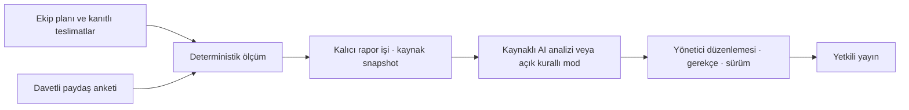

# Proje ölçümü, paydaş değerlendirmesi ve rapor

Bu akış proje yöneticisinin yönettiği projeler içindir. Unit işi yetkisi proje yönetim hakkına dönüşmez. Proje sayfasındaki **Ölçüm ve değerlendirme** alanı, PM'nin genel ilerleme beyanının yanında kanıtlı ekip ilerlemesini gösterir.

## Ölçüm yaklaşımı

Örnek: Dört ekip aynı projeye katkı verir. PM her ekip için bir plan ağırlığı, her teslimat/kilometre taşı için ağırlık, ilerleme ve kanıt tanımlar. Önce ekip içindeki teslimatlar, sonra ekip planları ağırlıklandırılır. Çok sayıda küçük iş açmak ekibin proje üzerindeki ağırlığını artırmaz. Tamamlanan görev sayısı, PM beyanı ve teslimat ilerlemesi ayrı ölçülerdir.

| Bileşen | Hesap | Sınır |
| --- | --- | --- |
| Teslimat | Ekip içi `Σ(ilerleme × teslimat ağırlığı) / Σağırlık`; ardından ekip ağırlıklı ortalama | Planlı ekipte teslimat yoksa hesap eksiktir. |
| Kalite | Kanıtlı 1–5 değerlendirme `(puan−1)×25`; aynı iki aşamalı ağırlık | Eksik kalite değerlendirmesi toplam kaliteyi belirsiz bırakır. |
| Paydaş görüşü | Son anketin yanıtlayan kişi başına eşit ağırlıklı ortalaması; `(ortalama−1)×25` | Yanıt oranı ve örneklem yanında görünür; yanıt yoksa puan yoktur. |
| Başarı endeksi | Teslimat %50 + kalite %30 + paydaş %20 | Üç bileşen de olmadan toplam üretilmez. Olasılık veya çalışan performans puanı değildir. |

Bu sabit formül ilk sürümün açık ürün tercihidir. AI sayıları keyfî değiştirmez; ölçümlerdeki güçlü yönleri, gecikmeleri, eksik kanıtları ve önerileri kaynaklarıyla açıklar. Anket sonucu tek başına nesnel kalite kanıtı sayılmaz. Devam eden projedeki değerlendirme geçicidir; kapanış yayını tamamlanmış proje gerektirir.

## Teslimat ve anket

PM veya görev kapsamı açıkça devredilmiş kişi teslimat/ilerleme/kanıt girer. Kalite, anket ve kapanış yetkisi ayrıca kontrol edilir. Ekip listesi proje sahibi ve kabul edilmiş katılımlardan gelir; tüm organizasyonu projeye ekleme yolu değildir. Her değişiklik sürüm kontrolü ve audit ile kaydedilir; ilerleme snapshot'ı tutulur.

Anketi kapanış yetkilisi açar ve projeye erişebilen etkin paydaşları seçer. Davetler uygulama içi bildirim ve outbox üzerinden iletilir. Anket **isimlidir**: katılımcı bunu cevaplamadan görür. Toplu sonuçlar, örneklem ve kişinin kendi cevabı gösterilir; adlandırılmış bireysel cevaplar yalnız anket yönetim yetkilisine açıktır. Anonimlik iddia edilmez. Davetli kişi süre dolmadan ve anket açıkken tek güncel yanıtını sürüm kontrollü değiştirebilir; önceki değer audit'te korunur. Kapanmış/süresi dolmuş ankette değişiklik yapılamaz.

## Düzenlenebilir rapor

Günlük, haftalık veya kapanış raporu istek üzerine kalıcı arka plan işiyle hazırlanır. Dönem, katkı kayıtlarını filtreler; teslimat puanları **üretim anındaki güncel snapshot**'tır. Geçmiş bir tarihteki proje durumu geriye dönük tahmin edilmez. İlerleme grafiği yalnız gerçekten kaydedilmiş snapshot'ları gösterir; tek örnekten tarihçe üretilmez.

1. Kaynak kayıt kimlikleri/sürümleri, erişim parmak izi ve hesaplanan değerler sabitlenir.
2. AI seçildiyse bağlantı profili, model ayarı ve bütçe sürümü de işe sabitlenir. Toplu anket ölçümleri kullanılır; kişi sıralaması üretilmez.
3. AI kullanılamıyorsa kaynaklı `RULE_BASED` taslak hazırlanır. Arayüz bu sonucu canlı AI çıktısı gibi sunmaz. Sağlayıcı çağrısı yapmadan kurallı rapor istemek de mümkündür.
4. **Hesaplanan değer**, **özgün AI/kurallı metin**, **yöneticinin düzelttiği metin ve puanlar** ayrı tutulur. PM/yetkili yönetici gerekçeyle metni ve değerlendirme puanlarını düzenler. Hesaplanan temel ve özgün metin değişmez; eski/yeni değer ve gerçek aktör izlenir.
5. Yayın ayrı yetki ve sürüm kontrolü ister. Kaynak veya erişim değiştiyse eski taslak sessizce yayımlanmaz; yeniden üretim gerekir. Kapanış raporu yalnız tamamlanmış projede yayımlanır.

## Erişim ve dayanıklılık

Proje yönetimi PM, PM atamasının bağlı olduğu Unit Head veya açık işlem kapsamındaki vekile aittir. Teknik sistem yöneticisi bu iş yetkisini otomatik kazanmaz. Salt okunur JWT yazamaz. Sadece yönetim özeti gören kişi teknik kanıtları, taslakları veya diğer ekiplerin iç kalite/anket ölçümlerini alamaz.

İş ve sonuç oturum belleğinde tutulmaz. PostgreSQL job kaydı, lease, checkpoint, kaynak/erişim kontrolü ve idempotent sonuç kaydı kullanılır. Kesintiden sonra aynı iş sürdürülebilir; erişimi geri alınmış aktör adına rapor tamamlanmaz. UI yalnız açık işi izler, her yenilemede AI çağrısı başlatmaz. Metinler Markdown kaynak olarak düzenlenir; HTML güvenilir kabul edilmez.

## Demo ve sınırlar

`seed_project_insights`, biri devam eden biri tamamlanmış iki açıkça işaretli dört ekipli demo proje, sekizer teslimat, paydaş cevapları ve günlük/haftalık/kapanış taslakları ekler. Gerçek AI çağırmaz; mevcut kullanıcı düzenlemelerini sıfırlamaz. İlerleme, kalite ve anket örnekleri kurgu veridir. Üretimde seed çalışmaz.

Kabul senaryoları [özellik kabul planında](../testing/FEATURE_ACCEPTANCE.md), API [sözleşmede](../API.md) bulunur. Kurumsal anketin istatistiksel geçerliliği, bağımsız denetçi kalite imzası, aylık geçmiş durumun yeniden inşası ve PPTX çıktısı bu sürümün iddiası değildir.
